# 交付物与文件预览：从「Agent 交付」到「点开看清」

> 状态：方案稿，未实施（2026-11-14）；2026-11-15 三轮修订：测试计划的 21 个问题、阻塞项深度调研、重写后测试计划的 23 个问题（§12）。
> 对标：Claude Code 桌面端的 `SendUserFile` 文件卡片、文件面板与 Outputs 清单；逐格式实测 28 个文件，结论见 §2。
> 前置：`present_files` 与 `offer_next_step` 已实现并提交（b23fb300）。本方案改造前者的契约，后者不动。

## 1. 要什么

**完成标准**：Agent 把成果声明为交付物后，用户在回复下方看到卡片，点开就能看清内容；看不了的格式有明确出口；整个会话的成果在侧栏一处能找到。

**最不想看到**：

- 点开是一句「无法预览」，然后无路可走。
- 同一种格式在卡片、文件面板、对话链接里表现不一致。
- 卡片上的类型、大小与磁盘上的文件对不上。
- 模型不调用工具时，回复比现在差。

**对标与偏离**：卡片形态、各格式的打开方式、看不了时的出口以对标对象为基线。有意偏离六处，理由见各节：

| 偏离 | 对标对象 | cosir |
|---|---|---|
| 交付物种类 | 只有文件 | 文件、目录、网址 |
| 部分失败 | 一个路径无效，整批不发 | 有效的照常呈现，无效的只告诉模型 |
| 说明文字 | 整批一句，在卡片外 | 每个条目一句，在悬停提示条里 |
| 缩略图 | 只有位图；SVG、PDF 是空白方块 | 位图与 SVG 用自身画面，其余用系统缩略图 |
| 大表格 | 只显示前 500 行 | 整文件读入上限内全部显示，超出看源码 |
| 看不了的文件 | 只有「在访达中显示」 | 另加「快速查看」与「用系统应用打开」 |

## 2. 对标实测结论

| 格式 | 对标对象 | cosir 现状 | 本方案 |
|---|---|---|---|
| Markdown（含 mermaid、公式、任务列表） | 文件面板渲染 | 渲染 / 源码可切，同一套渲染组件 | 不动 |
| HTML | 内置浏览器；同目录样式疑似未生效 | 内置浏览器，按本机文件地址打开 | 不动，实测相对引用 |
| PNG、JPG、GIF | 卡片缩略图，动图会动 | 无缩略图 | 卡片缩略图 |
| SVG | 缩略图空白，点开进浏览器 | 文件面板渲染 / 源码可切 | 卡片缩略图 |
| TIFF | 无缩略图，无预览 | 归为二进制 | 后端转成 PNG 预览（§4.2） |
| PDF | 缩略图空白，浏览器阅读器 | 文件面板阅读器 | 系统缩略图 |
| CSV、TSV | 可排序、可筛选的表格，500 行上限 | 纯文本 | 表格视图 |
| JSON、YAML、CSS、SQL、代码 | 高亮源码 | 同类编辑器组件，按文件名选语言 | 不动，实测 |
| 音频（wav、m4a） | 对话里直接出播放器 | 归为二进制 | 卡片内播放器，面板内播放 |
| 视频（mov） | 普通文件卡片，无封面；点开进浏览器后弹出「保存为」下载框，播不了 | 归为二进制 | 系统缩略图，面板内播放；播不了退到快速查看 |
| docx、xlsx、pptx | 无预览，可在访达中显示 | 无预览，无出口 | 系统缩略图、快速查看、另两个出口 |
| zip 等压缩包 | 同上 | 同上 | 两个出口（系统应用打开、在文件夹中显示） |
| mermaid 文件（`.mmd`） | 纯文本源码，指定内联渲染也不渲染 | 文本 | 渲染 / 源码可切 |
| 未知后缀的二进制 | 「看起来是二进制数据」，两个出口；提示语与 docx 的「没有内联预览」不同 | 无出口 | 两个出口，与认得的格式分两种说法（§4.4） |
| ipynb | 一行原始 JSON | 文本 | 不做（§7） |
| 无扩展名文本 | 角标 `FILE` | 文本 | 通用文件图标 |
| 目录 | 工具拒绝 | 工具拒绝 | 支持 |
| 网址 | 文件工具拒绝；打开网页时另有带截图的卡片，不进 Outputs | 正文链接 | 作为交付物条目 |
| 工作区外的文件 | 任意路径可在面板打开 | 只有网页能开 | 在文件夹中显示、快速查看、系统应用打开；进文件面板推迟（§4.9） |
| 会话级清单 | 环境面板的 Outputs 区 | 无 | 侧栏「产出」卡片 |

## 3. 模型看到什么

工具由 `present_files` 改名为 `present_deliverables`，只给侧栏会话，静默调用（卡片就是呈现，调用行只在失败时出现）。

**工具描述**：

```text
Show deliverables to the user as cards under your reply: files, directories, or web addresses. Use this for anything the user would want to open — a report, a generated diagram, a document, a built site, a page you are serving locally — when you want it surfaced, not just mentioned.

Do not present routine working files: scratch files, logs, intermediate output, or every file you edited. Edited files already appear in the change record. Do not present pages you only read for research.

Present something once it is complete. Present it again only if it has meaningfully changed. Files and directories must already exist.

After presenting, do not restate the contents in your reply. Give the key takeaways and say what you could not verify.
```

**参数**（strict）：

| 字段 | 约束 |
|---|---|
| `items` | 1–5 个 |
| `items[].target` | 一个字符串：工作区相对路径、工作区外的绝对路径，或 `http(s)://` 开头的网址 |
| `items[].caption` | 一句说明，可为 null；显示在悬停提示条里（参数描述照此写，不再写「显示在文件名下方」） |

一个字段而不是「路径或网址二选一」的两个可空字段：strict schema 下两个可空字段要靠入口再校验「恰好一个」，模型也更容易填错。种类由后端按 `http(s)://` 前缀与磁盘事实判定。

**结果**：逐个校验，有效的呈现，无效的在给模型的结果里点名，全部无效才失败。路径规则与 `read_file` 一致（可指向工作区外，拦设备路径与禁读的受保护路径，判定口径见 §4.7）；网址只校验协议，不联网。

## 4. 设计

### 4.1 交付记录：交付时观察，现状现读

**记录是持久化事实，不是展示数据。** 交付记录挂在工具结果行的强类型 metadata 上：`ToolMessageMetadata.delivery`，值对象与 `BackgroundWork` 并列放在 `models/message_metadata.py`，随 fork、撤回、删除自动跟随。这个工具的 `display_data` 为空，不存两份。展示数据按契约只给前端（`tool_observation.py:37`），而侧栏清单与以后的读取凭据都是后端要读的事实，所以不能放在那里；`artifact_data` 不落库，也不行。

```text
Delivery {items: [
  {type: "file",      key, workspace_path | null, absolute_path, caption, kind, size, system_preview},
  {type: "directory", key, workspace_path | null, absolute_path, caption},
  {type: "url",       key, url, caption, media: "audio" | "video" | null},
]}
```

| 字段 | 来源与用途 |
|---|---|
| `key` | 「同一指向」的唯一判等值，规则只在工具里：文件与目录取规范路径（§4.7 的 `canonical_path`），网址按一个手写的规范化子集（协议与主机小写、去掉 80 / 443 默认端口、空路径补 `/`、去掉片段；不做 IDNA 与百分号编码规范化，标准库没有现成实现，不为此加依赖），所以 `http://localhost:5173` 与 `http://localhost:5173/` 是同一指向。硬链接的不同名字会得到不同的 `key`，出两张卡，接受。工具内去重、回合内合并、侧栏清单三处只比较它 |
| `workspace_path` | 在工作区内时是相对 POSIX 路径，否则为空。前端据它区分内外，不自己解析盘符或反斜杠 |
| `kind`、`system_preview`、`size` | 交付那一刻由 `inspect_file` 观察得出。类型判定仍只在 `inspect_file` 一处，只是结果被记下来，用于排版。工作区外的文件以**解析后**真实路径所在的目录为根调用（交付的是指向别处的链接时，取输入路径的父目录会被句柄校验判为越界），不依赖推迟的 §4.9 |
| `media` | 网址后缀查后端的音视频后缀表（§4.2），前端不另存一张表 |

**流向**：工具 → `ToolObservation.delivery` → 终态事件 → `settle_observations` 写进 metadata → `project_tool_result` 投影为工具 part 上的 `deliverables` 字段（实时与冷重建同源）→ snapshot 顶层清单（§4.6）。与 `background` 有一处必须相反：事件不带记录时要清掉 part 上的记录，不是保留。驱动失败时补写的 `cancelled` 不带记录，冷重建时那一行也没有，卡片随之消失，模型没看到的结果用户也不该看到。

**什么冻结，什么现读**：

| 事实 | 工作区内的条目 | 工作区外的条目 |
|---|---|---|
| 排版类别（方块、胶囊、音频） | 由记录的 `kind`、`system_preview` 推出 | 同左 |
| 大小、是否存在、图片版本 | 现读，走文件面板现有的 `fileInfoQueryOptions`，与面板共用缓存和监听（§4.8） | 显示交付时的大小；被删后，点「在文件夹中显示」时才提示已不存在 |

**为什么本轮不按记录寻址读取**：卡片要读的工作区内信息，现有 `/files/info` 已经能读，而且它不依赖工具结果行是否已落库。按记录寻址的接口只对工作区外的文件有意义，那是推迟的阶段（§4.9）。这样「终态事件早于结果落库」的时间窗口（`tool_batch_runner.py:201` 先发事件、observe 节点后写行）本轮不存在，也不需要新的 service、错误码与重试。

### 4.2 文件类型

`FileInfo.kind` 由六类增至十类：

| 新类型 | 判定 | 预览 |
|---|---|---|
| `table` | 后缀 `.csv` / `.tsv` 且能解码为文本 | 表格视图，可切源码（与 Markdown 同样的双视图） |
| `mermaid` | 后缀 `.mmd` / `.mermaid` 且能解码为文本 | 把内容当作一个 mermaid 代码块交给现有的 Markdown 渲染组件，可切源码 |
| `audio` | 不是文本，且后缀在音频表里 | 播放器 |
| `video` | 不是文本，且后缀在视频表里 | 播放器 |

归类不用 `mimetypes`：它读本机的类型表，同一个后缀在不同机器上结果不同（`.key`、`.pages`、`.numbers` 在 macOS 上就没有类型）。后端在 `file_content.py` 旁维护一张显式的后缀表，是全仓唯一事实源：

| 表 | 后缀 |
|---|---|
| 音频 | mp3、wav、m4a、aac、flac、ogg、oga、opus |
| 视频 | mp4、m4v、mov、webm、mkv、avi |
| 系统可预览 | pdf、doc、docx、xls、xlsx、ppt、pptx、key、pages、numbers、rtf、odt、ods、odp、epub、heic、heif |

音频、视频两张表同时给出每个后缀的 MIME。这两类文件的 `FileInfo.mime` 与资源响应的 `Content-Type`（带 `nosniff`）取自表里，不取 `mimetypes`，否则同一个文件在不同机器上可能播不了。其余文件的 `mime` 仍只用于显示。

`FileInfo.system_preview` 在 `inspect_file` 里一处算出：最终 `kind` 为 `pdf` 或 `video`，或后缀在第三张表里。按最终类型而不是只按后缀，免得没有 `.pdf` 后缀的 PDF 拿不到缩略图。系统缩略图、「快速查看」按钮与二进制空态的说法都只读它。

图片类 `FileInfo` 增加 `width`、`height`（Pillow 只读文件头；**已先行完成**，2026-11-16）。像素超过 Pillow 两倍上限时 `Image.open` 抛 `DecompressionBombError`，文件头损坏时抛 `UnidentifiedImageError`（`OSError` 的子类，不捕获会被映射成 422 走读取问题界面），`inspect_file` 捕获这两种并把宽高置空，不让 `/files/info` 失败。`kind` 为 `image` 且宽高为空即「这张图无法预览」，前端直接显示二进制空态，不去请求资源；SVG 的宽高恒为空，不适用这条。AVIF 能否读出宽高取决于 Pillow 的构建，读不出时同样按无法预览处理。文件面板据此判断「当前显示的是缩小图」，并显示原图尺寸；`X-Cosir-Image-Preview` 响应头与它的 CORS 暴露一并删除。现在面板显示的「尺寸」其实是缩小后的尺寸，借此修正。

另：TIFF 按文件头（`II*\0` / `MM\0*`）识别为 `image`，资源接口把它转成 PNG（复用 `image_preview` 的转码路径）。只加 TIFF：HEIC 等其他浏览器内核不支持的格式仍归 `binary`，由系统缩略图与快速查看覆盖。相机 RAW（DNG、NEF、CR2）也以 TIFF 文件头开头，转码失败时按 §4.10 降级。

资源接口的类型白名单加 `audio`、`video`；接口已支持分段读取，播放器直接用地址，不整文件读入内存。浏览器内核播不了的容器（如 avi）由播放器的失败回调退到「看不了的文件」。

### 4.3 卡片

- **结构**：一个回合里的全部交付物调用合成一张聚合卡，写法照抄改动卡（`turn-layout.ts` 的 `changes`），放在本回合第一次交付调用的位置，按 `key` 只留最后一次。产物区直接吃卡片数据，不再逐调用回查 part。
- **排版类别**由一个纯函数从 `kind`、`system_preview` 与「宿主能否给缩略图」推出（新文件 `lib/assistant/turn/deliverable-layout.ts`），回合布局与估高共用，不需要先读文件信息。估高按「方块行数 + 胶囊行数 + 音频条数」算，胶囊每行按对话内容列最大宽度下的 3 枚估；估高没有宽度入参，窄窗口下的误差由虚拟列表的实测高度修正，不追求精确。胶囊里大小那一格定宽，网址胶囊的主机名截断到同一宽度，「12 KB」变成「已不存在」时胶囊宽度不变。
- **胶囊**有一个主操作（点名称区）和一个次操作，两者是并列的两个按钮，不嵌套（§11.1）。次操作是一个小菜单：在文件夹中显示；阶段四起加快速查看（macOS）、用系统应用打开。
- **主操作的去处**：工作区内的文件进文件面板，网页文件与本机地址进内置浏览器，工作区内的目录在文件树里展开，公网地址确认后交系统浏览器，全部经现有的 `use-open-link`。工作区外的文件与目录，主操作是「在文件夹中显示」。工作区内的目录若被浏览可见性隐藏（文件树里没有它），主操作同样退回「在文件夹中显示」。浏览器开发模式没有宿主，工作区外的条目不可点、只有悬停提示，开发期接受。音视频永远不交给内置浏览器（浏览器会把播不了的格式转成下载）：文件按 `kind`，网址按记录里的 `media`，确认后交系统浏览器。
- **图片方块**用 `` 直接加载带版本号的资源地址，加 `edge` 参数要缩小图（边长为方块的两倍）。带版本号且校验通过的响应改为长期缓存（`immutable`，附件已是这样，`attachments_api.py:72`），滚出视口再回来不重新下载。GIF 与动态 WebP 在字节预算内返回原文件，保住动画。灯箱契约加一个可选的 `previewSrc`：方块用小图，灯箱用原图；现有调用方（读图、浏览器截图、用户消息图片）不用改。`useImageResource` 的 blob 方案与没人用的 `queryKeys.fileResource` 删除，面板图片与 Markdown 本地图片改走同一条地址路径。**已先行完成**（2026-11-16）：资源接口的 `version` 改为必填，所有资源响应都按版本长期缓存；`edge` 与 `previewSrc` 只有交付物用，仍在阶段二。`` 带不了 `X-Trace-Id`，与附件相同，也读不到错误响应体：错误语义由文件信息查询承担，`onerror` 时先失效一次该文件的信息（处理版本过期），仍失败就显示二进制空态。SVG 不经 Pillow：方块与灯箱都用原始地址，不带 `edge`，也不设 `previewSrc`。
- **系统缩略图**：PDF、Office、视频用宿主 `files.thumbnail`（阶段四）。系统对不认识的格式不报错，而是返回通用白纸图标，所以只对 `system_preview` 为真的文件请求；其余用彩色文件图标。首次约 1 秒、之后 60–320 毫秒，先显示图标、到了再换。浏览器开发模式与 Linux 没有缩略图，一律是图标，排版类别随之退回胶囊。
- 音频在卡片内出播放器，`preload="none"`，历史里的音频不会每条都发请求。
- 异常表现见 §11.2。

### 4.4 看不了的文件

文件面板的二进制空态由「以文本方式查看」一个按钮变为：一张较大的系统缩略图，加三个按钮（快速查看、用系统应用打开、在文件夹中显示）和一个文字链接「以文本方式查看」。三个按钮同时放进阅读工具栏的「更多」，所有文件都能用。

空态分两种说法（对标做法），只按 `system_preview` 区分（§4.2）。这里的文案是唯一版本，设计稿与代码照抄：

| 情况 | 提示 | 按钮（主按钮在前） |
|---|---|---|
| `system_preview` 为真（Office、iWork、PDF 读取失败、视频播不了） | 「这种文件没有内置预览」 | 快速查看（macOS；其他平台没有，「用系统应用打开」升为主按钮）、用系统应用打开、在文件夹中显示 |
| 其余二进制（压缩包、未知格式） | 「这个文件不是文本，无法预览」 | 用系统应用打开、在文件夹中显示 |

两种都在下方带文字链接「以文本方式查看」。

宿主新增三个方法，入参都是绝对路径，只确认路径存在：

| 方法 | 作用 | 平台 |
|---|---|---|
| `files.thumbnail(路径, 边长)` | 操作系统生成的缩略图，返回图片数据 | macOS、Windows；Linux 没有，返回不可用 |
| `files.quickLook(路径)` | 系统的快速查看窗口（访达里按空格的那个）；调用前确认文件存在，并先显示主窗口（§8 第 4 项） | 仅 macOS |
| `files.openExternally(路径)` | 交给系统按默认应用打开 | 全部 |

`openExternally` **不做后缀限制**（用户决定，2026-11-14）。它是真的会启动关联程序，不只是显示；对 `.command`、`.app`、`.bat` 这类文件等同于执行。连同另两个接受任意路径的方法，记入 AGENTS 待办「安全与权限」，随整体权限方案一起收口。

### 4.5 表格视图

CSV 解析用 `papaparse`（新增依赖，自动识别分隔符，处理引号与内嵌换行）。行用现有的 `@tanstack/react-virtual` 虚拟滚动。支持按列排序、按文本筛选、显示行数。文件不超过整文件读入上限（2 MB）时全部显示。超出时只解析分段读到的开头一段（现有接口给 512 KB），截到 papaparse 解析出的最后一条完整记录（引号内可能有换行，不能按行截），表格上方一行写「只显示前 N 行，文件共 X MB」并给「以源码查看全部」；不做分页解析。

### 4.6 会话级产出

snapshot 顶层新增 `deliverables`：工作副本里全部工具 part 上 `deliverables` 字段的纯函数，新文件 `assistant_transport/state/conversation_state_deliverable.py`，写法照后台任务看板。

| 问题 | 规则 |
|---|---|
| 何时重算 | 整份重建时（撤回走这里），以及 `apply_planned` 处理的事件指向一个交付物 part 时。不能照抄看板的「事件带后台记录才重算」，否则失败补写清掉记录时清单不更新 |
| 继承的消息 | 计入。手动 fork 展示继承的历史与卡片，清单一致；Agent fork 的继承行不进 Transport，自然不在 |
| 同一指向 | 按 `key`，只留最后一次，新的在前 |
| 条目形状 | `{key, tool_call_id, index, turn, item}` |

侧栏注册一张「产出」卡片（`aside-card-registry.tsx`），条目与回复下方共用同一个条目组件（侧栏变体只显示角标与名称）。有过交付物才出现。侧栏**不探测文件是否存在**：清单常驻、条目会积累几十个，逐条探测就是几十个并发请求；点击时由现有的打开链路确认，不存在就提示（`use-open-workspace-path.ts:76`）。新增卡片 id 会让用户已存的侧栏顺序与折叠重置，store 的设计本来就是「不迁移」，绿地规则下接受。

### 4.7 路径身份

**现状**：仓里没有统一的「两个路径是不是同一个文件」「一个路径是否在某个目录之下」的判定，十几处各自比较字符串。macOS 上 `Path.resolve()` 与 `realpath` 保留输入的大小写和 `/System/Volumes/Data` firmlink 前缀，`normcase` 是恒等，所以 `~/.COSIR/.env` 与 firmlink 写法能绕过受保护路径（已实测，`validation.py:27` 的 docstring 声称的大小写处理不成立）。同一个文件写成不同大小写，还会出两张卡、被误判为工作区外。

**改造**：新增 `app/utils/path/file_identity.py`，用两个原语取代全部字符串比较：

| 原语 | 回答什么 | 做法 |
|---|---|---|
| `FileIdentity` | 同一个文件 | `(st_dev, st_ino)`，`os.stat` 跟随链接 |
| `RootDirectory.relative(path)` / `contains(path)` | 是否在某根之下（含尚不存在的路径） | **先** `os.path.realpath`（消掉 `..`、解析全部链接，尾部不存在的部分按字面保留），**再**从解析结果的叶子往上逐级 `stat`，第一个身份等于根的祖先之下即在根内；尾部不存在的那几级跳过，写新文件也能判。不能对未解析的输入直接比：根内指向外部的链接与 `ws/../out/x` 会被误判在内 |
| `canonical_path(path)` / `canonical_path_of(fd)` | 显示与记录用的规范路径 | 操作系统给句柄报出的路径：macOS 打开后取 `F_GETPATH`；Windows 用 `os.path.realpath(strict=True)`，它内部以 `FILE_FLAG_BACKUP_SEMANTICS` 打开、取 `GetFinalPathNameByHandleW`，目录同样适用（不用 `os.open`，它在 Windows 上打不开目录）。只用于显示和记录，不拿来做包含判断 |

身份判定不比字符串，大小写、firmlink、NFC/NFD、Windows 的 8.3 短名、`\\?\` 前缀、盘符大小写、junction 都不再是问题，也不按平台分支。祖先判定只用 `stat`，不打开目录：没有读权限的目录打不开但可以 `stat`，祖先判定也不会比现在更早触发 macOS 目录授权弹框。交付工作区外的文件时要打开它（取规范路径、读样本判类型），文件在桌面、文稿等受保护目录里时，授权框会在 Agent 调用工具那一刻弹出，接受（§9）。

**迁移**（被取代的逐条删除）：`utils/path/validation.py` 整个删除（`is_within`、`is_within_cosir`）；`image_utils.is_trusted_cosir_path` 只有测试在用，删除；`protected_paths`、`path_resolver`、`writable_root`、`atomic_write`（手写的祖先回溯）、`execute_terminal` 工作目录、`skill_catalog`、`attachment_service._inside`、文件服务的 `file_access` 与 `workspace_paths` 改用 `RootDirectory`；`opened_path` 搬进新模块；工作区登记改存规范路径，`_same_path` 的 casefold（在大小写敏感卷上会误合并两个目录）删除。遍历剪枝先比目录名（NFC + casefold 等于 `.cosir`），命中再比身份：Windows 上 `DirEntry.stat()` 的 `st_ino` 恒为 0，不能直接用。

不改的，各有理由：

| 位置 | 理由 |
|---|---|
| `utils/workspace_scope.py` | 作用域键刻意是纯字符串；工作区根改存规范路径后键自然一致 |
| `utils/scope_config_directory.py:86` | 两侧都是同一个已解析的根经 `glob` 拼出的路径，写法一致 |
| `storage/engine_cache.py:254` | 后端自己拼出的数据库路径，不是信任边界 |
| `service/workspace_files/file_watch.py:98` | 根路径与监听事件路径比字符串；工作区根改存规范路径后与系统报出的路径一致 |
| 其余后端自拼路径与纯词法相对化 | 不是信任边界 |

**回归证明**：除受保护路径的绕过外，阶段一还修一个现存缺陷：工作区以非磁盘大小写或 firmlink 写法登记后，文件面板里每个文件都 403（登记时存的是保留输入写法的 `resolve()`，读取时比的是系统报出的真实写法）。现有 `test_cosir_guard_probe_adversarial.py:79-90` 在 macOS 上把 `.COSIR` 断言为「不属于保留区」，等于把绕过写成了预期，阶段一改写它。

**Windows 的硬约束**：某个卷上根目录的 `st_ino` 若为 0（个别文件系统），身份比较会把整个卷判为「在根内」，`RootDirectory.at` 必须显式报错。实机验证清单见 §8 后的 Windows 小节。

**残留**：把 `.cosir` 里的文件硬链接进工作区，任何基于路径的判定都挡不住；终端本来就能直接读，归「安全与权限」待办。硬链接的规范路径也不稳定（macOS 的 `F_GETPATH` 报最近打开的那个名字，已实测），影响只是 `key` 不同、多出一张卡。

### 4.8 文件变化信号

**现状**：文件监听只由文件面板挂载（`workspace-files-surface.tsx:90`），面板只在打开时渲染。面板关着时，对话里的卡片收不到任何「文件变了」的信号。

**改造**：监听提升为工作区级，在 `AppLayout` 挂一次（复用现有的 `useFileWatch` 与聚焦刷新），新增 `lib/workspace-files/file-watch-store.ts` 按工作区记录登记的目录与引用计数。文件面板登记已展开的目录、标签所在目录与 Markdown 引用的图片；会话页登记本会话工作区内交付物的父目录（目录条目登记自身），集合取自 snapshot 顶层 `deliverables`（§4.6），所以清单投影与监听同在阶段二。store 按工作区分开记，`AppLayout` 为每个至少有一项登记的工作区各挂一个订阅（保活的会话页与当前文件面板可能属于不同工作区）；某个工作区的登记清零就关掉它的订阅。登记的是会话级集合，不是每张卡片各自登记：虚拟列表滚出即卸载，按卡片登记会让集合抖动、反复重连并整体失效全部文件查询。卡片的文件信息查询落在 `queryKeys.files(workspaceId)` 前缀下，监听的整体失效自然覆盖它。

`resource-watch.tsx` 整个删除，面板不再拥有监听，只声明要看哪些目录。工作区外的条目不监听（§4.1）。

**运行时成本**：订阅存在期间，每次重连的 `ready` 与每 15 秒的对账（轮询模式每 2 秒）都会整体失效该工作区的文件查询，react-query 只重拉已挂载的查询，所以是可见卡片与面板各一次本机 `files/info`，接受。订阅只在有登记时存在：会话没有工作区内交付物、面板也关着时没有订阅，现有 E2E「收起面板后订阅数为 0」在这种情况下仍成立，有交付物的情况另写用例。

**原生事件是尽力而为**（2026-11-16 查清）：原生监听用例与两条集成 E2E 的不稳定，根因是本机 fseventsd 满载（CPU 持续 100% 以上），纯 watchdog 脚本也复现，事件迟到十几秒或丢失；cosir 的登记、路由与推送链路没有缺陷。操作系统不保证投递时限，产品由 15 秒对账与聚焦刷新兜底；测试因此不再断言投递时限：后端改为注册与路由两个确定性测试，E2E 夹具写完文件后经监听器送合成事件。阶段二接入交付物卡片后，按实际体验再评估 15 秒是否够用。

**每个工作区只注册一次**（2026-11-16 已完成）：在后端进程里注册原生监听会占住 GIL，注册期间整个后端冻住（watchdog 与 watchfiles 实测都如此），系统繁忙时一次 0.2–2 秒；原来按目录登记，前端每展开一个目录就注册一次，表现为展开目录「加载中」数秒、同时 Agent 输出也卡住。现在每个工作区在根上注册一个递归监听，订阅只是过滤集合（根、`.cosir` 与所请求的目录），展开目录不再注册；最后一个订阅离开 60 秒后才释放。根目录被改名或删除时递归监听直接报出并停止，不再单独监听根的父目录；128 个目录上限与超限转轮询随之删除。每次注册的耗时记进日志（`workspace_watch_registered`），若经常超过 0.5 秒，再把监听挪到独立子进程。阶段二提升为常驻时沿用这一结构。

**Windows 风险**：watchdog 在 Windows 上为每个注册持有一个目录句柄，被监听目录或其祖先可能无法在资源管理器里重命名。现在每个工作区只在根上持有一个句柄，有订阅期间与最后一个订阅离开后 60 秒内，用户可能改不了工作区文件夹（或其上级）的名字；父目录已不再监听。列入 Windows 待验证清单。

### 4.9 推迟：工作区外的文件进文件面板

用户决定推迟（2026-11-15）。工作区外的文件本轮有完整出口（在文件夹中显示、快速查看、用系统应用打开），只是不能在 cosir 里渲染。以后做时按下面的设计，已与本轮的记录与路径身份对齐：

- 路由 `GET /sessions/{id}/deliverables/{call_id}/{index}/{info|text|resource}`（`api/deliverable_files_api.py`）；领域规则在 `service/deliverables/delivered_file_service.py`；存储层加按调用 id 取工具结果行的查询。
- 只认可见的记录：`project_to_transport` 且 `include_in_context`。撤回、Agent fork 隐藏、下标越界都是 404 `DELIVERABLE_NOT_FOUND`；调用已出现但结果行未落库是 409 `DELIVERABLE_NOT_SETTLED`（读取由用户点击触发，提示「正在完成，稍后再试」即可）；Session 不存在是 404 `SESSION_NOT_FOUND`，不复用 `KeyError → WORKSPACE_NOT_FOUND`。
- 读取范围参数化为两个具体类：`WorkspaceScope`（工作区子树）与 `DeliveredFile`（打开后 `canonical_path_of(fd)` 等于记录的 `key`，或文件身份等于交付时记下的身份，任一成立即可）。只认路径会误拒硬链接（规范路径报出的名字不稳定），只认身份会误拒原子替换（编辑器与 `atomic_write` 会换 inode），两者取或。每次读取重查受保护路径。
- 403 拆成 `ACCESS_DENIED`（系统拒绝，如 macOS 目录授权被拒）与 `OUTSIDE_SCOPE`（越界）：新增 `OutsideScopeError`，替换现有三处越界抛出，接口按类型映射。
- 文件面板容纳「来自交付物」的标签：不能加入对话引用、不在文件树里定位、没有文件监听。

### 4.10 兜底：没有「不支持的格式」

对标对象的工具说明里没有任何格式限制，只要求文件存在；实测未知后缀、二进制文件都照常出卡片，差别全在点开之后。cosir 采用同一条规则，分三层保证任何文件都有去处：

| 层 | 规则 |
|---|---|
| 工具 | 不按格式拒绝，只校验路径。工具描述因此不需要列「支持哪些格式」，模型不用为格式做判断 |
| 类型 | 每个文件恰好落进一类，有两个兜底类：能解码为文本的归 `text`（按源码显示），其余归 `binary`（二进制空态，§4.4）。新增类型只是从兜底类里分出一类，不分也能用 |
| 预览 | 预览器显示不了时降级到 `binary` 的空态，说明原因并给出口，不停在错误页。缩略图取不到退回文件图标 |

降级只针对「显示不了」，另外两种失败保留现有处理：

| 失败 | 例子 | 处理 |
|---|---|---|
| 显示不了 | 媒体格式不支持、papaparse 致命错误、PDF 解析异常、TIFF 转码失败 | 降级到二进制空态 |
| 读取失败 | 网络中断、404、403、5xx | 现有的读取问题界面（`file-read-problem.tsx`），可重试 |
| 太大 | SVG 超 8 MB 的 413 | 现有的「切到源码分段阅读」 |

位图不分「无法识别」与「像素过大」：`` 读不到错误码，两者都是「无法预览这张图片」，进二进制空态并给出口；宽高为空的图片在请求资源前就这样处理（§4.2）。媒体元素在 404、409 时也报格式错误，播放器出错时先重读一次文件信息，文件还在且版本未变才判为「显示不了」。降级在 `file-preview` 的分发处统一做，各预览器只上报「我显示不了」。

## 5. 分阶段

| 阶段 | 内容 | 验证 | 删除 |
|---|---|---|---|
| 一 | 路径身份（§4.7）：新模块与全部调用点迁移，修受保护路径绕过 | 身份与包含判定单测（大小写、firmlink、NFD、写新文件、链接逃逸、`..` 逃逸、硬链接、根 `st_ino` 为 0）；工作区以不同大小写登记后文件面板可读；现有路径与受保护路径测试改写后全绿 | `validation.py`、`is_trusted_cosir_path`、各处字符串比较与重复规范化 |
| 二 | 交付记录与卡片（§4.1、§4.3）：工具改名与 `delivery`；契约文档、提示词、工具目录同步，加提示词工具名守卫；回合聚合卡、排版类别、估高；snapshot 顶层 `deliverables`（§4.6，监听的登记集合取自它）；监听提升（§4.8，先修不稳定的原生监听用例）；`edge`、`previewSrc`（图片地址缓存与 `FileInfo` 图片尺寸已先行完成） | 工具、透传、清除语义测试；清单投影纯函数测试（去重、继承、撤回、失败清除、重算时机）；前端单测；E2E 点卡片进面板、浏览器、文件树（测试服务没有文件接口，用 `page.route`）；一次改完全部内联 snapshot 的测试夹具 | `display/deliverables_display.py`、旧卡片与读取函数、`resource-watch.tsx`、`useImageResource`、`fileResource` 键、`X-Cosir-Image-Preview` |
| 三 | 类型与预览（§4.2、§4.5、§4.10）：后缀表、`system_preview`、TIFF、表格、媒体、降级；`.ipynb` 按 JSON 高亮 | `inspect_file` 类型测试；E2E 表格排序筛选、音频播放（wav、ogg、webm） | 无 |
| 四 | 宿主三个方法；系统缩略图接进卡片；胶囊菜单与二进制空态的出口 | 宿主入参校验单测；E2E 用假宿主断言调用（假宿主平台改为按用例传参，默认仍是 linux）；macOS 人工实测缩略图与快速查看 | 无 |
| 五 | 侧栏「产出」卡 | E2E 侧栏卡 | 无 |

每个阶段结束都能独立使用。AGENTS 的对应条目（kind 清单、宿主能力、snapshot 顶层字段、文件监听、待办）随各自阶段写，不留到最后。阶段一与交付物功能无关、可以先单独交付。

## 6. 改动账本（预估）

| 阶段 | 增 | 减 | 主要文件 |
|---|---|---|---|
| 一 | 约 +215（模块 +95，测试 +120） | 约 −355（应用 −155，测试 −200） | 新增 `utils/path/file_identity.py`；删除 `utils/path/validation.py` |
| 二 | 约 +920（后端 +255，前端 +245，夹具 +40，测试 +380） | 约 −215 | 新增 `lib/assistant/turn/deliverable-layout.ts`、`lib/workspace-files/file-watch-store.ts`、`assistant_transport/state/conversation_state_deliverable.py`、`reply-presentation/deliverable-item.tsx`；改名 `present_files.py` → `present_deliverables.py`；删除 `display/deliverables_display.py`、`resource-watch.tsx` |
| 三 | 约 +500（后端 +50，前端 +300，测试 +150） | 约 −10 | 新增 `workspace-files/table-preview.tsx`、`media-preview.tsx` |
| 四 | 约 +160 | 约 −10 | 宿主 `ipc.ts`、`host-contract.ts`、preload、`lib/desktop-host`、`fake-desktop-host.ts` |
| 五 | 约 +150（侧栏卡 +110，测试 +40） | 0 | 新增 `conversation-aside/deliverables-aside-card.tsx` |
| **合计** | **约 +1945** | **约 −590** | **净约 +1355**；推迟的 §4.9 约 +350 |

交付后以 `git diff --stat` 对账。

**消费方**：工具名（`tool_names`、`schemas/__init__`、`define_agents`、`tool_registration`、前端 `tool-catalog`、提示词 `work_layer`、`test_session_tool_scope`、契约文档）；交付记录（观察、事件、结算、`project_tool_result`、前端契约类型、回合布局、估高、产物区、snapshot 清单）；`FileInfo`（资源白名单、前端类型、`file-preview` 分发、面板图片）；snapshot 顶层字段（后端快照模型与校验、前端严格校验、全部内联 snapshot 的测试夹具）。

**刻意不做**：委派与分叉从 `display_data` 取 `child_session_id`（同类问题，改多 Agent 时再处理）；终态事件直接携带整份 metadata、去掉几处重复拷贝（单独改造）；每个工具调用结束即写结果行（影响全部工具，本轮不需要）；文件变化事件带路径做精细失效；监听工作区外的交付物。

## 7. 不做的，以及为什么

| 项 | 理由 | 什么时候重新考虑 |
|---|---|---|
| ipynb 渲染成单元格 | 成熟的编辑器都渲染，这一项是推迟而不是不需要。完整渲染要处理代码、输出、图表、富文本，是一个独立的预览器；对标对象也只显示原始 JSON，cosir 的主场景是写代码 | 有数据分析类用户 |
| 网址卡片的页面截图 | 成熟的链接卡片显示站点图标、标题和地址，不靠实时截图；截图只有页面此刻开着才能取到 | 不考虑 |
| Office 文档在应用内解析渲染 | 快速查看已覆盖 macOS，还原度由系统保证；自己解析要引入多个库且还原度更差。Windows 上退回「用系统应用打开」 | Windows 成为主要平台 |
| 展示方式参数 | 实测对标对象上这个参数没有可见差别 | 不考虑 |

**判断修订记录**（2026-11-14）：初稿把 PDF 缩略图、Office 预览、工作区外文件都列为不做，理由分别是「要加载 PDF 引擎」「要引入解析库」「等于重做文件面板的保护」。三条理由都只考虑了一种昂贵的实现：前两项改用操作系统自带的缩略图与快速查看，第三项改用按交付记录授权的读取，都不需要原先设想的代价。TIFF 同理改为做（后端已有转码路径）。

## 8. 实测结论

2026-11-15 逐项查清（Electron 44.7.2、macOS，隐藏窗口脚本）。八项已定，方案结构不变，带来的调整已写回对应小节。

| # | 问题 | 结论 | 依据 |
|---|---|---|---|
| 1 | 动图在 `ImageTile` 里是否播放 | 会动 | 缩略图是普通 ``（`components/image/image-tile.tsx:95`），无静帧处理 |
| 2 | 内容安全策略是否拦音视频 | 不拦 | 应用页面与宿主都没有设置内容安全策略（`index.html`、`electron/` 全文无匹配）；图片已按同一方式从后端地址加载 |
| 3 | 系统缩略图的画质与耗时 | 可用 | PDF、docx、xlsx、视频都是真实内容，保持原始宽高比（不是正方形，卡片需裁切铺满）；首次约 1.1 秒，之后 60–320 毫秒；未知格式与音频返回通用图标而不报错，只有文件不存在才失败（调整见 §4.3） |
| 4 | 快速查看的窗口表现 | 可用，两条约束 | `BrowserWindow.previewFile` 实测：面板浮在主窗口之上并取得焦点，自带「用默认应用打开」与分享按钮；面板开着时再次调用只换内容，不叠窗口；`closeFilePreview` 能关。约束一：文件不存在时面板照样打开，显示空白的「未选定项目」，所以宿主方法先确认文件存在，不存在按缺失状态返回。约束二：主窗口隐藏时面板开在其他应用后面，用户看不到，所以宿主方法先显示并聚焦主窗口再调用（按钮在主窗口里，正常不会走到这一步） |
| 5 | mov 能否直接播 | 能 | 桌面录屏原片（3248×1942）、转成 HEVC 的 mov、转成 H.264 的 mp4 都能加载到可播放；非媒体文件触发 `error` 事件（code 4），可据此降级到二进制空态。这只在 macOS 硬件解码下成立：Windows 播 HEVC 需要系统扩展，Playwright 自带的 Chromium 连 H.264 都不解，所以「能不能播」不写死，一律靠失败回调降级；自动化测试只用 wav、ogg、webm |
| 6 | macOS 目录授权 | 机制已定，弹框未实测 | 被拒时读取抛 `PermissionError`，现有接口映射为 403（`workspace_files_api.py:51`），与 404 的「文件不存在」本来就是两个状态；交付物读取端点沿用这组映射，卡片按状态码分文案；403 另按错误码区分系统拒绝与链接越界（§4.9）。授权记在拉起后端的应用名下。弹框出现的时机要在打包后的应用里看，开发期记在终端名下，看不到真实表现 |
| 7 | YAML、CSS、SQL 高亮 | 都有 | `LanguageDescription.matchFilename` 对三者均命中。顺带查出没有高亮的：`.ipynb`、`.mmd`、`.env`、`.log`、`.graphql`、`Makefile`；其中 `.ipynb` 是 JSON，阶段三把它按 JSON 高亮并格式化 |
| 8 | 本机 HTML 的相对引用 | 生效 | 以 file 地址打开（`resolve-link.ts:80`），相对样式表生效、相对链接可跳转 |

## 9. 已知代价

- 交付物工具调用后，模型要再说一轮才能写最终回复，多一次模型请求。
- 工具改名后，已有会话里固化的旧工具名调用会失败；绿地项目不做兼容，需新开会话。
- 弱模型可能不调用或乱调用。不调用时回复与现在一致；乱调用只能靠工具描述约束。
- 快速查看只有 macOS 有，Windows 上 Office 文档少一种查看方式。
- 工作区外的条目显示交付时的大小，被删后要点击才知道；侧栏清单不显示条目是否还在。
- 交付桌面、文稿等受保护目录里的文件时，macOS 授权框在 Agent 调用工具那一刻弹出。
- 图片长期缓存只在打包后的应用里生效：开发期 Electron 的界面会话关掉了缓存（`window.ts:70`），要人工验证。
- 交付时记下的类型不随文件变化：文件后来被换成另一种格式，卡片仍按原类别摆放，内容退回图标。
- FAT/exFAT 上修改时间精度是 2 秒，两秒内同尺寸重写可能得到同一个版本号，长期缓存会显示旧图。
- Windows 上监听可能妨碍重命名工作区文件夹（§4.8，待实测）。

## Windows 实机验证清单

与 AGENTS 待办里的 Windows 清单一起测：

1. NTFS、ReFS、exFAT、SMB 共享、subst 盘上目录的 `st_ino` 是否非 0 且稳定；为 0 时 `RootDirectory.at` 报错。
2. 用 junction、目录符号链接、8.3 短名、`\\?\C:\`、小写盘符、UNC 写法访问 `%USERPROFILE%\.cosir\.env`，读写入口都被拒。
3. 硬链接文件上 `GetFinalPathNameByHandleW` 返回的名字（影响 §4.9 的记录比对）。
4. subst 与映射盘上的工作区：规范路径会还原成真实路径，「在工作区内」的判断与显示路径是否符合预期。
5. 遍历剪枝：`os.stat(entry.path)` 的身份能与 `%USERPROFILE%\.cosir` 对上。
6. 工作区登记：从对话框选同一目录的不同大小写写法能去重。
7. 文件监听持有工作区根的目录句柄时（有订阅期间与之后 60 秒内），资源管理器能否重命名工作区文件夹与其上级。
8. `files.thumbnail` 对 PDF、Office、视频的画质与耗时；`openExternally` 对 `.bat`、`.exe` 的表现。
9. 视频播放：HEVC 需要系统扩展，播不了时是否正确降级。
10. 递归监听下重命名或删除工作区根目录：watchdog 的 Windows 监听线程是否随之退出，订阅是否经 `check_health` 转轮询并让前端看到工作区已不存在（macOS 已实测会报出根目录删除）。
11. 读文件是否触发自己的刷新循环：watchdog 订阅了「最后访问时间变化」并当作修改上报，系统开着最后访问时间更新时，前端刷新 → 后端读文件 → 访问时间变 → 推送变化 → 再刷新。只在实测出现时修（事件处理里忽略纯访问时间变化），不预先防。
12. E2E 的真实后端夹具建了两个软链接（`alias`、`loop`），未开开发者模式时 Windows 建软链接要管理员权限，夹具启动即失败、整组文件面板 E2E 跑不了；随「启动与测试入口」一起处理。

## 10. 样式参照（对标对象实测截图）

截图是原图，未裁剪，共 29 张，在 [`benchmark/`](benchmark/)。每张图的左栏是对话区，右栏是点开卡片后的面板。「取」是 cosir 照做的样式，「不取」是有意不同的地方。

### 10.1 文件卡片

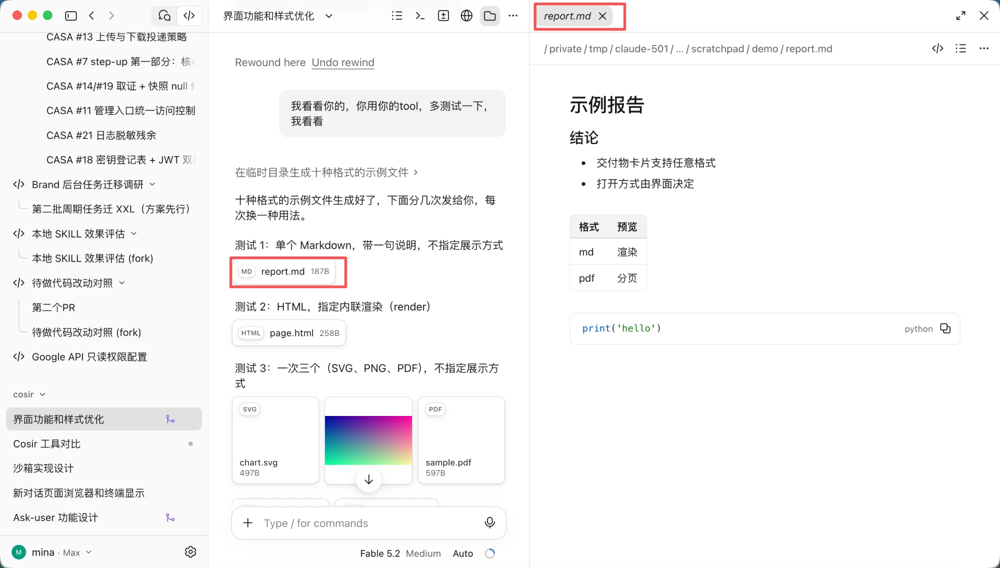

- 白底、细边框、圆角的小胶囊，单行：类型角标（灰色描边的大写后缀）· 文件名 · 浅灰色的大小。
- 多个文件横向排开，放不下换行（见下面 `17-yaml-source`）。
- 整张可点，没有独立按钮；悬停出完整路径的提示条（`12-tsv-table`、`28-unknown-binary`）。
- 文件名过长时从中间截断，保住扩展名（`25-video-folder-permission`）。
- 说明文字不在卡片里，是卡片上方的一行正文。

取：单行胶囊、整张可点、悬停路径、中间截断、横排换行。
取：文字角标。不取：说明文字放卡片外（cosir 每个条目一句，放提示条）。

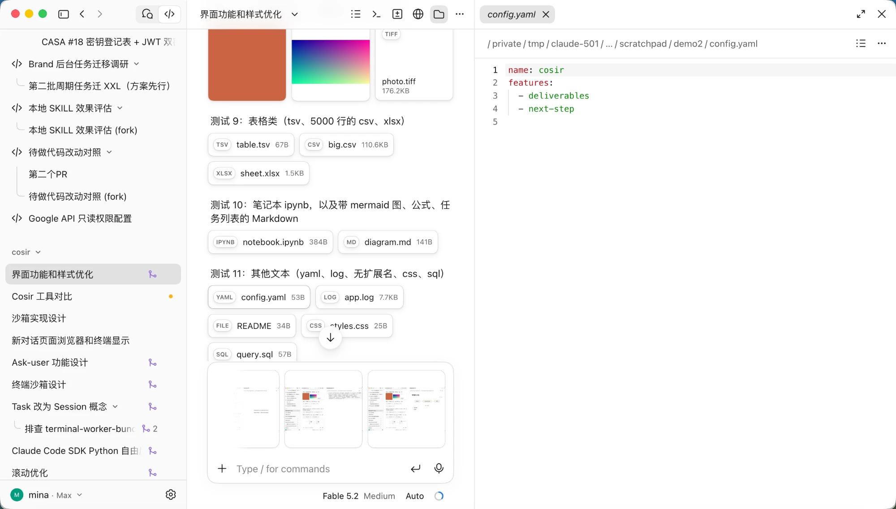

### 10.2 图片类卡片

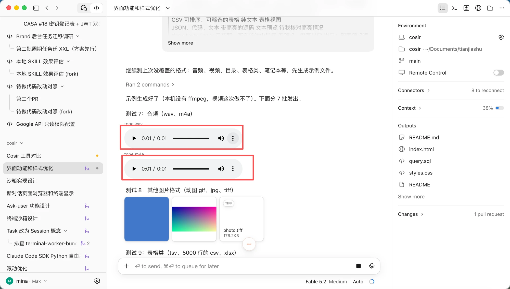

- 位图是正方形大方块，画面裁切铺满，方块上不显示文件名；动图在方块里播放。
- 取不到画面的格式（TIFF，以及 `05-pdf-viewer` 里的 SVG、PDF）是空白方块：左上角文字角标，左下角文件名与大小。
- 三个方块横排，与胶囊卡片分行。

取：位图用大方块、裁切铺满、动图播放。
不取：空白方块（cosir 对 SVG 用自身画面，对 PDF、Office、视频用系统缩略图，都取不到才退回图标）。

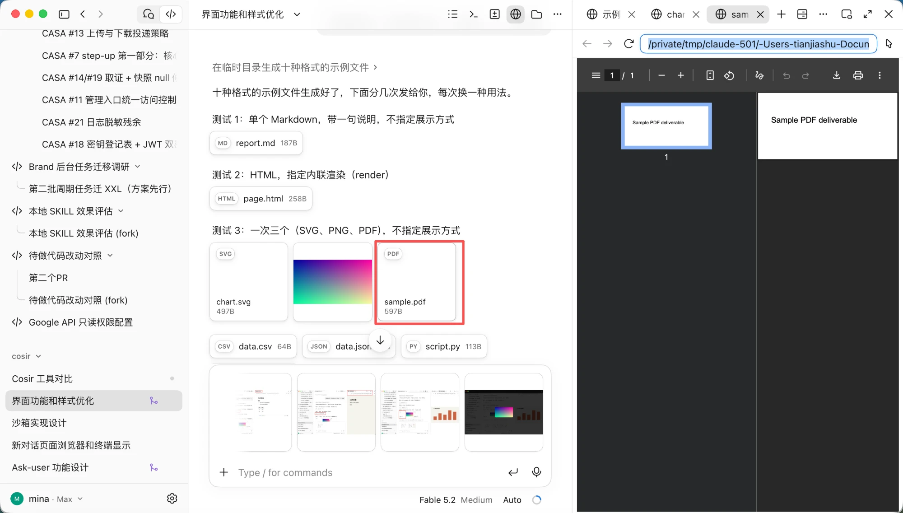

### 10.3 音频

见上面 `11-audio-players-and-outputs`：不是卡片，是灰色胶囊形的播放器，上方一行小字文件名，含播放键、进度、时长、音量与更多菜单。

取：对话里直接出播放器、文件名在上方。

### 10.4 文件面板

- 顶部是斜体文件名的标签，可关闭；下面一行灰色的路径（工作区外显示绝对路径并折叠中段，工作区内显示相对路径，对比 `01-markdown-panel` 与 `21-workspace-file-relative-path`）。
- 右上角三个图标：源码切换、大纲、更多。只有源码一种形态的文件没有源码切换（`07-json-source`）。

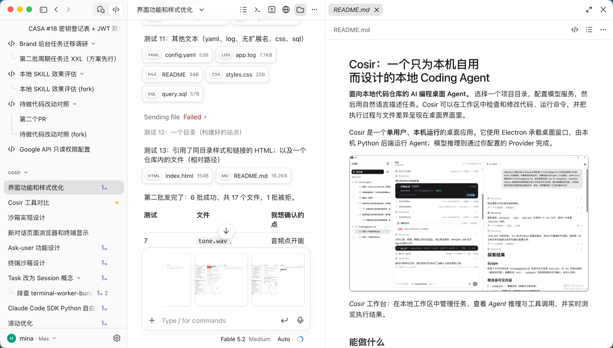

cosir 的文件面板已有同样的结构（路径、视图切换、更多），不改。

### 10.5 表格视图

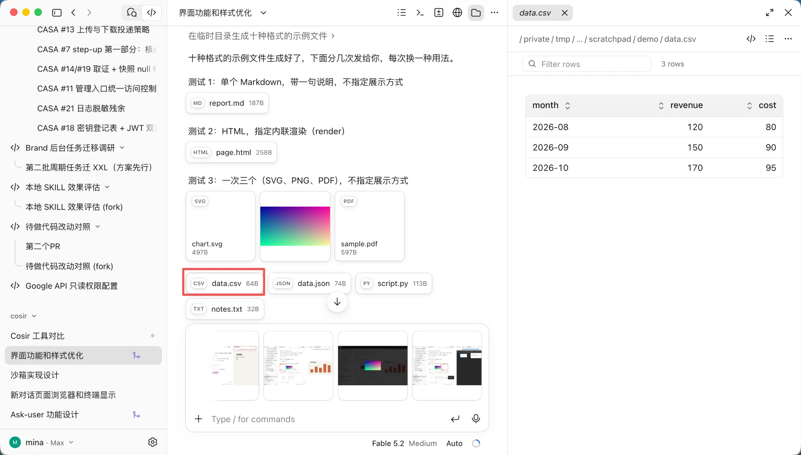

- 顶部一行：筛选输入框、行数。
- 表头浅灰底，每列带排序箭头；数字列右对齐，文本列左对齐；行间细分隔线；表格有圆角外框，不铺满面板宽度。
- 超过 500 行时在表格上方提示切到源码（`13-csv-500-row-limit`）。

取：筛选框加行数、排序箭头、数字右对齐、圆角外框。
不取：500 行上限（§4.5）。

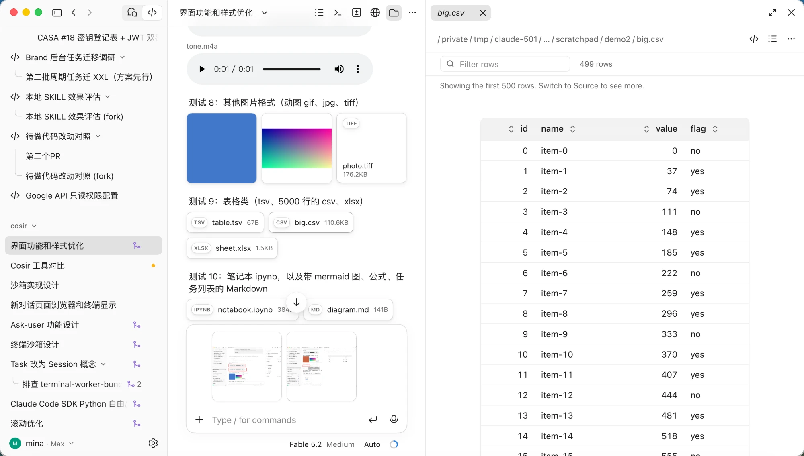

### 10.6 看不了的文件

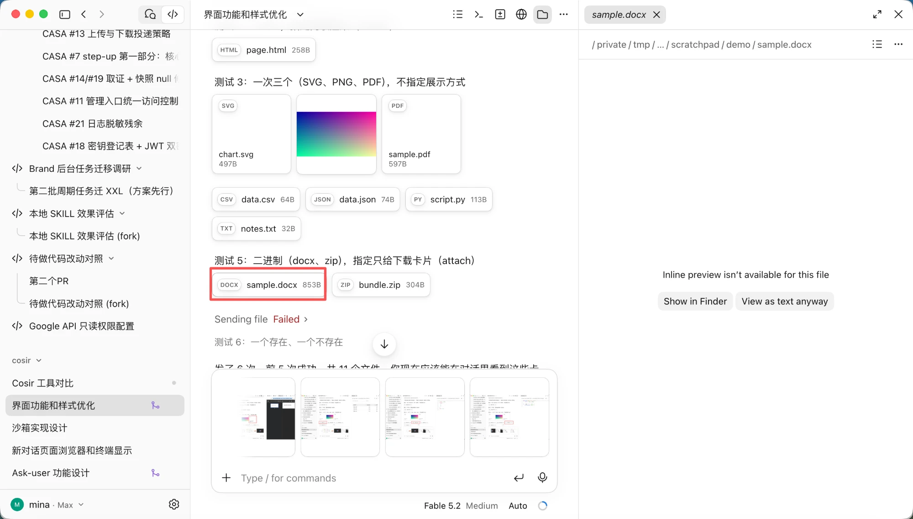

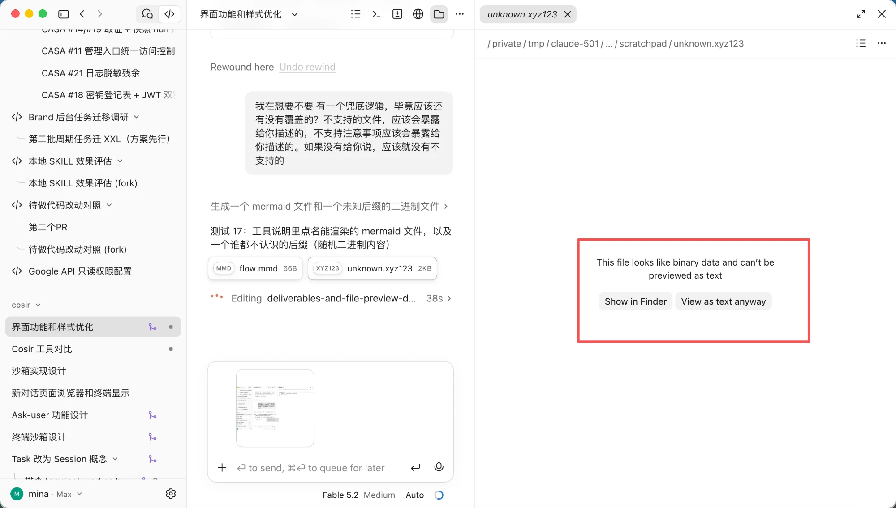

- 面板正中一句提示，下面一排浅灰底的按钮，四周留白。
- 两种提示语不同：认识的格式是「没有内联预览」，不认识的是「看起来是二进制数据」（cosir 的文案见 §4.4）。

取：居中布局、两种提示语。
cosir 另加：提示上方一张系统缩略图；认得的格式多出「快速查看」与「用系统应用打开」，「以文本方式查看」降为文字链接。

### 10.7 网址卡片

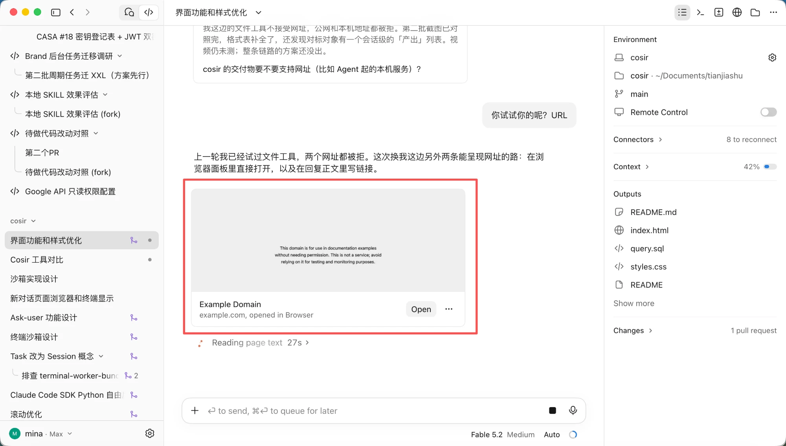

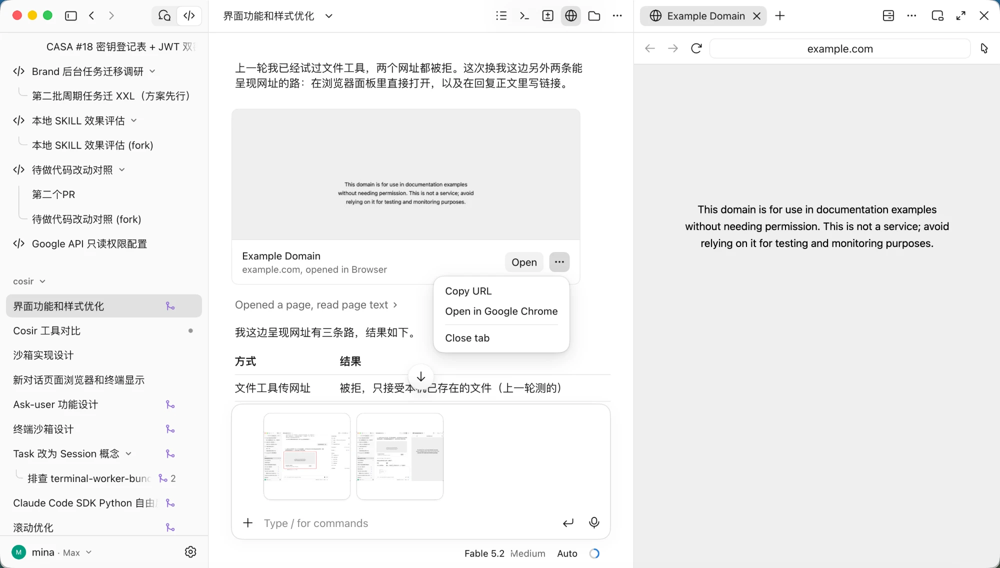

- 大卡片：上半部分是页面截图，下半部分左侧标题与「域名，已在浏览器打开」，右侧「打开」按钮与「…」。
- 「…」菜单：复制网址、在系统浏览器打开、关闭标签。
- 这张卡片来自「打开网页」的动作，不是文件工具，也不进 Outputs。

取：「…」菜单里的复制网址与用系统浏览器打开。
不取：页面截图（§7）；卡片绑定活的标签页（cosir 的网址条目是成果的指向，与文件条目同一种胶囊）。

### 10.8 会话级清单

见 `11-audio-players-and-outputs` 右栏的 Outputs：每行一个小图标加文件名，图标按类型分（文档、网页、代码、通用），超过五条折叠为「显示更多」。

取：单行条目、图标加名称、折叠。cosir 放在会话侧栏的「产出」卡片里（§4.6）。

### 10.9 对标对象没做好的地方（留作反例）

| 截图 | 问题 |
|---|---|
| [`26-video-save-dialog`](benchmark/26-video-save-dialog.webp) | 视频交给浏览器后落进「保存为」下载框 |
| [`25-video-folder-permission`](benchmark/25-video-folder-permission.webp) | 读桌面目录触发系统授权框（cosir 同样会遇到，见 §8） |
| [`15-ipynb-raw-json`](benchmark/15-ipynb-raw-json.webp) | 笔记本显示成一行原始 JSON |
| [`29-mermaid-file-render-flag`](benchmark/29-mermaid-file-render-flag.webp) | mermaid 文件指定内联渲染后仍是源码 |
| [`20-html-relative-assets`](benchmark/20-html-relative-assets.webp) | 网页引用的同目录样式疑似未生效（标题应为橙色） |

### 10.10 其余截图

各格式点开后的样子，实施时按需对照：[`02` HTML](benchmark/02-html-browser.webp)、[`03` SVG](benchmark/03-svg-browser.webp)、[`04` 图片放大](benchmark/04-png-lightbox.webp)、[`07` JSON](benchmark/07-json-source.webp)、[`08` Python](benchmark/08-python-source.webp)、[`10` 压缩包](benchmark/10-zip-binary.webp)、[`12` TSV](benchmark/12-tsv-table.webp)、[`14` xlsx](benchmark/14-xlsx-no-preview.webp)、[`16` Markdown 图表与公式](benchmark/16-markdown-mermaid-math.webp)、[`18` CSS](benchmark/18-css-source.webp)、[`19` SQL](benchmark/19-sql-source.webp)、[`23` 网址卡片与浏览器](benchmark/23-url-card-with-browser.webp)、[`27` mermaid 源码](benchmark/27-mermaid-file-source.webp)。

## 11. 界面设计

设计稿是一张可打开的页面：[`ui-mockup.html`](ui-mockup.html)（颜色、圆角、字号照抄 `styles/globals.css` 的令牌，右上角切换深浅色；文档与视频的缩略图是占位画法）。§10 是对标对象长什么样，本节是 cosir 自己长什么样；两者冲突以本节为准。

**原则**：不新造视觉语言。胶囊没有外层卡片，图片用对话里唯一的图片外观（`ImageStrip` / `ImageTile`），侧栏卡用 `aside-card` 外壳，按钮用 `Button` 现有三档。新增的视觉元素只有三个：交付物胶囊、表格视图、二进制空态。

### 11.1 交付物（对话里）

照对标截图 `01`、`05`、`11`、`17` 的做法：一个文件一枚胶囊，有画面的文件用方块，没有外层卡片，直接跟在正文下面。

| 元素 | 规格 |
|---|---|
| 胶囊 | 高 36、圆角 `--radius`、细边框、`shadow-xs`、底色 `--card`；横排、间距 8、放不下换行。胶囊本身是容器，里面并列两个按钮：主按钮（角标、文件名、大小）与次按钮（出口菜单：在文件夹中显示，阶段四起加快速查看与用系统应用打开），不嵌套 |
| 角标 | 描边的圆角小标，大写后缀，9.5 / 600、次要色；目录与网址换成线性图标 |
| 文件名 | 14 / 500，最宽 260，中间截断（扩展名与结尾始终可见） |
| 大小 | 12 / 次要色、等宽数字；目录写「文件夹」，网址写主机名加外链箭头 |
| 悬停与焦点 | 胶囊内任一按钮悬停或取得焦点时，底色变灰，次按钮出现在大小的位置；提示条挂在主按钮上，第一行是模型写的说明，第二行是完整路径。键盘按 Tab 先到主按钮、再到次按钮 |
| 方块 | 120×96（沿用 `ImageTile` 的尺寸与圆角）。图片只有画面、不写文件名，点开进灯箱；PDF、Office、视频填系统缩略图，左上角标、底部一条写文件名与大小，视频叠播放标记 |
| 音频 | 小字文件名在上，下面一条胶囊形播放条（播放键、时间、进度），高 36 |
| 顺序 | 方块一行 → 胶囊 → 音频。一个回合里多次交付物调用合成一组，按调用顺序排，同一指向只留最后一次 |

与对标对象的差别只有两处：对标取不到画面时是空白方块，这里填系统缩略图；对标的说明是卡片上方的一行正文，这里每个条目一句、放在提示条里（正文本身已经在介绍这些文件）。

### 11.2 状态

| 状态 | 表现 |
|---|---|
| 悬停 / 键盘焦点 | 见上；取得焦点的按钮另有 `focus-ring` |
| 不存在（工作区内，现读得知） | 虚线边框、文件名划线变灰、不可点，大小的位置写「已不存在」；不用警示色（文件被移走是正常事） |
| 无法访问（工作区内，现读得 403） | 与「不存在」同样的灰色虚线，写「无法访问」，不可点。403 可能是文件被换成越界链接、没有读权限或系统拒绝访问，本轮分不开，用中性说法；分错误码随 §4.9 |
| 其他读取失败（422、5xx、网络） | 胶囊照常显示，大小一格写「—」，可点；点开后由打开链路显示具体错误 |
| 工作区外 | 外观与普通胶囊一致；大小是交付时的值；主操作是「在文件夹中显示」 |
| 缩略图加载中 | 先显示占位方块（角标加文件名），到了再换，尺寸不变 |
| 无系统缩略图（浏览器开发模式、Linux） | PDF、Office、视频退回胶囊；浏览器开发模式另没有次按钮 |

「没有权限」（锁形角标）只会出现在工作区外的读取里，随 §4.9 推迟。

### 11.3 文件面板

- **表格视图**：筛选框与「匹配数 / 总行数」放进阅读工具栏；表头吸顶、点击排序（升 → 降 → 还原）；最左是原始行号，筛选排序后不变；数字列右对齐、等宽数字；横向滚动只发生在表格内；超限时表格上方一行「只显示前 N 行，文件共 X MB」并给「以源码查看全部」（§4.5）。
- **二进制空态**：居中一列——缩略图（最大 136 高，带投影）或通用图标、文件名、「类型 · 大小」、一句说明、出口按钮，文案与按钮以 §4.4 的表为准。「以文本方式查看」是文字链接，它几乎总是乱码，不与有用的出口同权重。
- **音视频**：视频黑底等比居中、原生控件；播不了时整块换成二进制空态并说明原因。
- **工作区外的标签**：随 §4.9 推迟。

### 11.4 侧栏「产出」卡

单行条目（类型标记 + 名称），最新在上；同一目标交付多次只留最近一次；不探测是否存在（§4.6），点击时由打开链路确认；点击行为与对话里的卡片一致；没有交付物时整张卡不出现；数量只在折叠时显示在标题右侧（`aside-card` 现有行为）。

### 11.5 回合内的顺序

正文 → 产物区 → 下一步建议。产物区内沿用现有规则（`artifact-zone.tsx`）：本轮改动卡在前，其余按调用顺序，交付物组排在它所在的位置；间距沿用回合内现有的 `gap`。下一步建议的样式不变。

## 12. 修订记录（2026-11-15）

**第一轮**：测试计划查出 21 个问题，逐条定案（图片进灯箱、显式后缀表与 `system_preview`、二进制空态文案唯一版本、降级只针对「显示不了」、胶囊内两个并列按钮等），已并入正文。

**第二轮**：独立审查认为第一轮修订仍不能开工，按四个方向深度调研后归为 9 个根因，统一改造：

| 根因 | 改造 | 落点 |
|---|---|---|
| 没有统一的路径身份口径（受保护路径可被大小写与 firmlink 绕过） | 新增文件身份与规范路径两个原语，迁移全部调用点，单独成为阶段一 | §4.7 |
| 读取凭据放在展示数据里 | 交付记录作为工具结果行的强类型 metadata | §4.1 |
| 卡片比结果行先出现 | 本轮不按记录寻址读取，工作区内走现有 `/files/info`；推迟阶段用 409 | §4.1、§4.9 |
| 对话里没有文件变化信号 | 监听提升为工作区级，面板与会话各自登记目录 | §4.8 |
| 排版要先知道类型 | 交付时记下类型，排版类别由一个纯函数推出 | §4.1、§4.3 |
| 判等规则三处各写 | 工具算出 `key`，三处只比较它 | §4.1 |
| 图片不缓存、灯箱只有一个地址 | 版本化地址长期缓存，灯箱加 `previewSrc` | §4.3 |
| 文件服务读不了工作区外文件 | 随工作区外读取推迟，设计已定 | §4.9 |
| 阶段依赖倒置 | 删阶段六，契约文档、提示词随改名进同一阶段；AGENTS 随各阶段写 | §5 |

撤回第一轮的两项：侧栏偏好「保留旧顺序」（store 的设计就是不迁移）；「阶段一的按记录寻址信息接口」（工作区内不需要，工作区外推迟）。

**第三轮**：重写后的测试计划查出 23 个问题（`test-plan.md` §6），逐条并入正文。阻塞测试的两条：包含判定必须先解析路径再比身份（Q1，第二轮合成方案时漏写了这一步）；工作区外的文件以所在目录为根做类型观察（Q2）。其余：403 改用中性的「无法访问」；侧栏不划线；snapshot 清单提前到阶段二（监听的登记集合取自它）；监听按工作区分订阅、无登记即关闭、先修不稳定的监听用例；位图失败统一进空态；音视频的 MIME 取自后缀表；Windows 规范路径用 `realpath(strict=True)`；迁移清单补「不改」的三处与理由；§4.9 的记录比对改为规范路径或文件身份任一相等；网址判等用 WHATWG 规范化。
