# 交付物与文件预览：从「Agent 交付」到「点开看清」

> 状态：方案稿，未实施（2026-11-14）；2026-11-15 按测试计划查出的 21 个问题修订（§12）。
> 对标：Claude Code 桌面端的 `SendUserFile` 文件卡片、文件面板与 Outputs 清单；逐格式实测 28 个文件，结论见 §2。
> 前置：`present_files` 与 `offer_next_step` 已实现（未提交）。本方案改造前者的契约，后者不动。

## 1. 要什么

**完成标准**：Agent 把成果声明为交付物后，用户在回复下方看到卡片，点开就能看清内容；看不了的格式有明确出口；整个会话的成果在侧栏一处能找到。

**最不想看到**：

- 点开是一句「无法预览」，然后无路可走。
- 同一种格式在卡片、文件面板、对话链接里表现不一致。
- 卡片上的类型、大小与磁盘上的文件对不上。
- 模型不调用工具时，回复比现在差。

**对标与偏离**：卡片形态、各格式的打开方式、看不了时的出口以对标对象为基线。有意偏离六处，理由见各节：

| 偏离 | 对标对象 | cosir |
|---|---|---|
| 交付物种类 | 只有文件 | 文件、目录、网址 |
| 部分失败 | 一个路径无效，整批不发 | 有效的照常呈现，无效的只告诉模型 |
| 说明文字 | 整批一句，在卡片外 | 每个条目一句，在悬停提示条里 |
| 缩略图 | 只有位图；SVG、PDF 是空白方块 | 位图与 SVG 用自身画面，其余用系统缩略图 |
| 大表格 | 只显示前 500 行 | 整文件读入上限内全部显示，超出看源码 |
| 看不了的文件 | 只有「在访达中显示」 | 另加「快速查看」与「用系统应用打开」 |

## 2. 对标实测结论

| 格式 | 对标对象 | cosir 现状 | 本方案 |
|---|---|---|---|
| Markdown（含 mermaid、公式、任务列表） | 文件面板渲染 | 渲染 / 源码可切，同一套渲染组件 | 不动 |
| HTML | 内置浏览器；同目录样式疑似未生效 | 内置浏览器，按本机文件地址打开 | 不动，实测相对引用 |
| PNG、JPG、GIF | 卡片缩略图，动图会动 | 无缩略图 | 卡片缩略图 |
| SVG | 缩略图空白，点开进浏览器 | 文件面板渲染 / 源码可切 | 卡片缩略图 |
| TIFF | 无缩略图，无预览 | 归为二进制 | 后端转成 PNG 预览（§4.2） |
| PDF | 缩略图空白，浏览器阅读器 | 文件面板阅读器 | 系统缩略图 |
| CSV、TSV | 可排序、可筛选的表格，500 行上限 | 纯文本 | 表格视图 |
| JSON、YAML、CSS、SQL、代码 | 高亮源码 | 同类编辑器组件，按文件名选语言 | 不动，实测 |
| 音频（wav、m4a） | 对话里直接出播放器 | 归为二进制 | 卡片内播放器，面板内播放 |
| 视频（mov） | 普通文件卡片，无封面；点开进浏览器后弹出「保存为」下载框，播不了 | 归为二进制 | 系统缩略图，面板内播放；播不了退到快速查看 |
| docx、xlsx、pptx | 无预览，可在访达中显示 | 无预览，无出口 | 系统缩略图、快速查看、另两个出口 |
| zip 等压缩包 | 同上 | 同上 | 两个出口（系统应用打开、在文件夹中显示） |
| mermaid 文件（`.mmd`） | 纯文本源码，指定内联渲染也不渲染 | 文本 | 渲染 / 源码可切 |
| 未知后缀的二进制 | 「看起来是二进制数据」，两个出口；提示语与 docx 的「没有内联预览」不同 | 无出口 | 两个出口，与认得的格式分两种说法（§4.4） |
| ipynb | 一行原始 JSON | 文本 | 不做（§7） |
| 无扩展名文本 | 角标 `FILE` | 文本 | 通用文件图标 |
| 目录 | 工具拒绝 | 工具拒绝 | 支持 |
| 网址 | 文件工具拒绝；打开网页时另有带截图的卡片，不进 Outputs | 正文链接 | 作为交付物条目 |
| 工作区外的文件 | 任意路径可在面板打开 | 只有网页能开 | 交付物授权读取（§4.7） |
| 会话级清单 | 环境面板的 Outputs 区 | 无 | 侧栏「产出」卡片 |

## 3. 模型看到什么

工具由 `present_files` 改名为 `present_deliverables`，只给侧栏会话，静默调用（卡片就是呈现，调用行只在失败时出现）。

**工具描述**：

```text
Show deliverables to the user as cards under your reply: files, directories, or web addresses. Use this for anything the user would want to open — a report, a generated diagram, a document, a built site, a page you are serving locally — when you want it surfaced, not just mentioned.

Do not present routine working files: scratch files, logs, intermediate output, or every file you edited. Edited files already appear in the change record. Do not present pages you only read for research.

Present something once it is complete. Present it again only if it has meaningfully changed. Files and directories must already exist.

After presenting, do not restate the contents in your reply. Give the key takeaways and say what you could not verify.
```

**参数**（strict）：

| 字段 | 约束 |
|---|---|
| `items` | 1–5 个 |
| `items[].target` | 一个字符串：工作区相对路径、工作区外的绝对路径，或 `http(s)://` 开头的网址 |
| `items[].caption` | 一句说明，可为 null |

一个字段而不是「路径或网址二选一」的两个可空字段：strict schema 下两个可空字段要靠入口再校验「恰好一个」，模型也更容易填错。种类由后端按 `http(s)://` 前缀与磁盘事实判定。

**结果**：逐个校验，有效的呈现，无效的在给模型的结果里点名，全部无效才失败。路径规则与 `read_file` 一致（可指向工作区外，拦设备路径与禁读的受保护路径），并记下解析掉链接后的真实路径（§4.7 据此校验）；网址只校验协议，不联网。

## 4. 设计

### 4.1 一个原则：卡片只存指向，事实现读

展示数据只记「指向哪」：

```text
{kind: "deliverables", items: [
  {type: "file" | "directory", path, absolute_path, real_path, caption},
  {type: "url", url, caption},
]}
```

类型、大小、是否还在，一律现读，工具执行时把这些写进展示数据会形成第二事实源，文件一改卡片就错。现读走一个按交付记录寻址的接口：`GET /sessions/{id}/deliverables/{call_id}/{index}`，返回与文件面板相同的 `FileInfo`（目录返回目录标记）。工作区内外的条目走同一个接口，卡片不区分；它在阶段一就有，只读文件信息。读取文本与资源的授权在阶段五（§4.7），两者共用同一套记录校验。

文件是什么类型，全仓只有后端 `inspect_file`（`service/workspace_files/file_content.py`）一处在判，前端预览器都按它的结果分发。本方案在这一处加类型，不新增判定点。

### 4.2 文件类型

`FileInfo.kind` 由六类增至十类：

| 新类型 | 判定 | 预览 |
|---|---|---|
| `table` | 后缀 `.csv` / `.tsv` 且能解码为文本 | 表格视图，可切源码（与 Markdown 同样的双视图） |
| `mermaid` | 后缀 `.mmd` / `.mermaid` 且能解码为文本 | 把内容当作一个 mermaid 代码块交给现有的 Markdown 渲染组件，可切源码 |
| `audio` | 不是文本，且后缀在音频表里 | 播放器 |
| `video` | 不是文本，且后缀在视频表里 | 播放器 |

归类不用 `mimetypes`：它读本机的类型表，同一个后缀在不同机器上结果不同（`.key`、`.pages`、`.numbers` 在 macOS 上就没有类型）。后端在 `file_content.py` 旁维护一张显式的后缀表，是全仓唯一事实源：

| 表 | 后缀 |
|---|---|
| 音频 | mp3、wav、m4a、aac、flac、ogg、oga、opus |
| 视频 | mp4、m4v、mov、webm、mkv、avi |
| 系统可预览的文档 | pdf、doc、docx、xls、xlsx、ppt、pptx、key、pages、numbers、rtf、odt、ods、odp、epub、heic、heif，以及视频表 |

`FileInfo` 新增一个布尔字段 `system_preview`（后缀在第三张表里）。系统缩略图、「快速查看」按钮与二进制空态的说法都只读它，前端不再各自猜。

另：TIFF 按文件头（`II*\0` / `MM\0*`）识别为 `image`，资源接口把它转成 PNG（复用 `image_preview` 的转码路径）。只加 TIFF：HEIC 等其他浏览器内核不支持的格式仍归 `binary`，由系统缩略图与快速查看覆盖。转码不等于缩小，`X-Cosir-Image-Preview: thumbnail` 只在确实缩小时带上，TIFF 原尺寸转码不带，避免面板误标「大图缩略预览」。

资源接口的类型白名单加 `audio`、`video`；接口已支持分段读取，播放器直接用地址，不整文件读入内存。浏览器内核播不了的容器（如 avi）由播放器的失败回调退到「看不了的文件」。

### 4.3 卡片

- 胶囊有一个主操作（点名称区）和一个次操作（「在文件夹中显示」，仅桌面宿主），两者是并列的两个按钮，不嵌套（结构见 §11.1）。
- 主操作的去处：工作区内的文件进文件面板，网页文件与本机地址进内置浏览器，工作区内的目录在文件树里展开，公网地址确认后交系统浏览器，全部经现有的 `use-open-link`。工作区外的文件在阶段五之前主操作是「在文件夹中显示」，阶段五起进文件面板；工作区外的目录始终是「在文件夹中显示」（目录不做授权浏览）。
- 内容：类型角标、名称、大小；说明与完整路径在悬停的提示条里（样式见 §11.1）。名称过长时从中间截断，保住扩展名（对标做法）。
- 音视频永远不交给内置浏览器：浏览器遇到播不了的格式会转成下载（对标对象的 mov 就落进了下载框），在 cosir 里还会往工作区下载目录多存一份。文件按 `kind` 判断；网址条目的路径后缀在音频或视频表里时，确认后交系统浏览器。
- 缩略图分两个来源：位图与 SVG 用文件自身的画面（复用 `ImageTile`，动图照常播放）。卡片不下载原图：资源接口加一个缩略尺寸参数（边长上限为方块的两倍），复用 `image_preview` 的缩小路径，按文件版本缓存，历史里的图片卡不再每次重下原图；PDF、Office 文档、视频等用**系统缩略图**（宿主 `files.thumbnail`，由操作系统生成，不引入任何解析库）。系统对不认识的格式不报错，而是返回一张通用的白纸图标（音频是通用音符），所以「有没有真实画面」不能靠调用成败判断：只对 `system_preview` 为真的文件请求系统缩略图，其余直接用彩色文件图标（复用文件浏览的 `WorkspaceFileIcon`）；文件不存在时调用才失败，同样退回图标。首次调用约 1 秒、之后 60–320 毫秒，卡片先显示图标、缩略图到了再换，按路径与修改时间缓存。浏览器开发模式没有宿主，一律是图标；Linux 上 Electron 不提供缩略图接口，同样是图标。
- 音频在卡片内出播放器。
- 文件已不存在、没有权限、链接越界三种异常各有表现（§11.2）。

### 4.4 看不了的文件

文件面板的二进制空态由「以文本方式查看」一个按钮变为：一张较大的系统缩略图，加三个按钮（快速查看、用系统应用打开、在文件夹中显示）和一个文字链接「以文本方式查看」。三个按钮同时放进阅读工具栏的「更多」，所有文件都能用。

空态分两种说法（对标做法），只按 `system_preview` 区分（§4.2）。这里的文案是唯一版本，设计稿与代码照抄：

| 情况 | 提示 | 按钮（主按钮在前） |
|---|---|---|
| `system_preview` 为真（Office、iWork、PDF 读取失败、视频播不了） | 「这种文件没有内置预览」 | 快速查看（macOS；其他平台没有，「用系统应用打开」升为主按钮）、用系统应用打开、在文件夹中显示 |
| 其余二进制（压缩包、未知格式） | 「这个文件不是文本，无法预览」 | 用系统应用打开、在文件夹中显示 |

两种都在下方带文字链接「以文本方式查看」。

宿主新增三个方法，入参都是绝对路径，只确认路径存在：

| 方法 | 作用 | 平台 |
|---|---|---|
| `files.thumbnail(路径, 边长)` | 操作系统生成的缩略图，返回图片数据 | macOS、Windows；Linux 没有，返回不可用 |
| `files.quickLook(路径)` | 系统的快速查看窗口（访达里按空格的那个），Office 文档的还原度由系统保证；调用前确认文件存在，并先显示主窗口（§8 第 4 项） | 仅 macOS |
| `files.openExternally(路径)` | 交给系统按默认应用打开 | 全部 |

`openExternally` **不做后缀限制**（用户决定，2026-11-14）。它是真的会启动关联程序，不只是显示；对 `.command`、`.app` 这类文件等同于执行。连同另两个接受任意路径的方法，记入 AGENTS 待办「安全与权限」，随整体权限方案一起收口。

### 4.5 表格视图

CSV 解析用 `papaparse`（新增依赖，自动识别分隔符，处理引号与内嵌换行）。行用现有的 `@tanstack/react-virtual` 虚拟滚动。支持按列排序、按文本筛选、显示行数。文件不超过整文件读入上限（2 MB）时全部显示。超出时只解析分段读到的开头一段（现有接口给 512 KB），丢掉被截断的最后一行，表格上方一行写「只显示前 N 行，文件共 X MB」并给「以源码查看全部」；不做分页解析。

### 4.6 会话级产出

snapshot 顶层新增 `deliverables`：后端工作副本里全部交付物工具 part 的纯函数，与后台任务看板同一种写法（`conversation_state_background_task.py`），但规则有四处不同，逐条定下：

| 问题 | 规则 |
|---|---|
| 何时重算 | 交付物工具的结果投影进工作副本时、撤回之后、整份重建时。不能照抄看板只在后台状态事件上重算的时机，否则清单永不刷新 |
| 继承的消息 | 计入。手动 fork 展示继承的历史，回复下方的卡片也照常显示，清单与之一致；Agent fork 的继承行本就不进 Transport，自然不在 |
| 同一指向 | 文件与目录按 `real_path` 判等；网址按规范化后的地址判等（去掉片段，协议与主机小写，其余原样）。同一指向只留最后一次，新的在前 |
| 条目形状 | `{tool_call_id, index, type, path 或 url, caption, turn}`。`tool_call_id` 与 `index` 就是 §4.1 接口的寻址键，侧栏点开工作区外的文件也用它 |

撤回的回合在构造 part 时已排除。后端工作副本存完整历史，所以清单不受前端历史窗口影响。

侧栏注册一张「产出」卡片（`aside-card-registry.tsx`），条目与回复下方的卡片共用同一个条目组件。有过交付物才出现。新增卡片 id 不能清掉用户已存的侧栏偏好：现在的归一化要求顺序数组与卡片清单等长（`conversation-aside-store.ts:43`），改为保留已知 id 的顺序、把新 id 追加在末尾。

### 4.7 工作区外的交付物：交付物即授权

文件面板的保护不动：它仍只接受工作区相对路径，并在打开文件后按句柄校验没有越出工作区。工作区外的文件走另一条读取路径，凭据不是路径，而是「这是一次已记录的交付」：

- Agent 调用交付物工具时，后端已校验该路径（可读、不在受保护目录内），并把解析掉链接后的真实路径 `real_path` 随工具结果行落库。
- 文件信息接口（§4.1）之外，再加文本与资源两个只读接口，同样按「会话、调用、第几个条目」寻址。前端传不了任意路径，后端只认自己记录过的那个文件。只认仍可见的记录：调用所在回合被撤回后，三个接口都按「已不存在」返回 404，与它在界面上消失一致。
- 读取复用现有的类型判定、分段读文本与资源响应。校验不按目录：打开后按句柄取真实路径，必须与记录的 `real_path` 完全相等，否则拒绝；每次读取还重查一遍受保护路径。按目录校验会放行整棵子树：交付 `~/report.md` 后把它换成指向 `~/.cosir/.env` 的链接，仍落在 `~` 之内。
- 403 分两个错误码：系统拒绝访问（如 macOS 目录授权被拒）为 `ACCESS_DENIED`，链接越出工作区或越出记录为 `OUTSIDE_SCOPE`。现在两者共用一个 403 和同一句文案（`workspace_files_api.py:51`），卡片会把越界链接也画成锁。拆分在文件服务与授权接口一起做：越界改抛专门的异常类型，接口按类型映射。
- 文件面板的标签现在按工作区相对路径标识，需要能容纳一种「来自交付物」的标签。这类标签没有工作区语义：不能加入对话引用、不在文件树里定位、没有文件监听（内容变了要手动刷新）。

这一节涉及文件面板的寻址方式，是一次独立的功能改造，放在最后一个阶段，开工时按第零铁律单独核对消费方。前四个阶段不依赖它：在它完成前，工作区外的文件在卡片上有类型、大小与系统缩略图（§4.1 的信息接口），主操作是「在文件夹中显示」，打不开文件面板，因此也用不上面板里的快速查看与系统应用打开。

### 4.8 兜底：没有「不支持的格式」

对标对象的工具说明里没有任何格式限制，只要求文件存在；实测未知后缀、二进制文件都照常出卡片，差别全在点开之后。cosir 采用同一条规则，分三层保证任何文件都有去处：

| 层 | 规则 |
|---|---|
| 工具 | 不按格式拒绝，只校验路径。工具描述因此不需要列「支持哪些格式」，模型不用为格式做判断 |
| 类型 | 每个文件恰好落进一类，有两个兜底类：能解码为文本的归 `text`（按源码显示），其余归 `binary`（二进制空态，§4.4）。新增类型只是从兜底类里分出一类，不分也能用 |
| 预览 | 预览器显示不了（播放器报格式错误、表格解析出错、PDF 解析失败、图片解码失败）时降级到 `binary` 的空态，说明原因并给出口，不停在错误页。缩略图取不到退回文件图标 |

降级只针对「显示不了」，另外两种失败保留现有处理，不混进来：

| 失败 | 例子 | 处理 |
|---|---|---|
| 显示不了 | 媒体 `error` 码 4、papaparse 致命错误、PDF 解析异常 | 降级到二进制空态 |
| 读取失败 | 网络中断、404、403、5xx | 现有的读取问题界面（`file-read-problem.tsx`），可重试 |
| 太大 | SVG 超 8 MB 的 413、图片像素超预算的 400 | 现有的「切到源码分段阅读」 |

降级在 `file-preview` 的分发处统一做，各预览器只上报「我显示不了」，不各自画失败界面。

## 5. 分阶段

| 阶段 | 内容 | 验证 | 删除 |
|---|---|---|---|
| 一 | 工具改名与三种条目；交付物信息接口（§4.1）与 403 拆分；新卡片（自身缩略图、大小、三种异常）；估高 | 后端工具与接口测试；前端单测；E2E 点卡片进面板、浏览器、文件树 | 旧卡片的两个按钮与路径手工编码 |
| 二 | 三个新类型、后缀表与 `system_preview`、TIFF；表格、媒体预览；降级分三种 | `inspect_file` 类型测试；E2E 表格排序筛选、音频播放 | 无 |
| 三 | 宿主三个方法；系统缩略图接进卡片；二进制空态的出口 | 宿主入参校验单测；E2E 用假宿主断言调用；桌面实测缩略图与快速查看 | 无 |
| 四 | snapshot `deliverables`；侧栏卡片；侧栏偏好归一化 | 投影纯函数测试（去重、继承、撤回、重算时机）；E2E 侧栏卡片 | 无 |
| 五 | 工作区外文件的文本与资源授权读取；交付物标签 | 接口测试（只认已记录且可见的条目、真实路径不符即拒、重查受保护路径）；E2E 打开工作区外的 Markdown 与图片 | 工作区外文件主操作为「在文件夹中显示」的分支 |
| 六 | 契约文档、AGENTS、`.ipynb` 按 JSON 高亮 | 守卫测试 | 无 |

每个阶段结束都能独立使用。

## 6. 改动账本（预估）

| 项 | 行数 |
|---|---|
| 精简：旧卡片按钮与接线、`present_files` 工具与参数 | 约 −110 |
| 后端：工具、参数、展示投影 | 约 +90 |
| 后端：类型判定、TIFF 转码、资源白名单 | 约 +45 |
| 后端：产出清单投影与校验 | 约 +100 |
| 后端：交付物授权读取接口 | 约 +110 |
| 后端测试 | 约 +240 |
| 前端：条目组件、卡片、读取 | 约 +220 |
| 前端：表格预览 | 约 +170 |
| 前端：媒体预览 | 约 +60 |
| 前端：二进制空态与工具栏入口 | 约 +70 |
| 前端：侧栏卡片 | 约 +110 |
| 前端：文件面板容纳交付物标签 | 约 +120 |
| 前端：契约类型、估高、工具目录 | 约 +45 |
| 宿主：缩略图、快速查看、系统应用打开 | 约 +70 |
| 前端单测与 E2E | 约 +400 |
| **净变化** | **约 +1740** |

**文件**：

- 改名：`tools/tool_handler/present_files.py` → `present_deliverables.py`，参数模型与展示投影同步改名。
- 新增：`assistant_transport/state/conversation_state_deliverable.py`、`api/deliverable_files_api.py`、`workspace-files/table-preview.tsx`、`workspace-files/media-preview.tsx`、`reply-presentation/deliverable-item.tsx`、`conversation-aside/deliverables-card.tsx`。

**消费方**：工具名（`tool_names`、`schemas/__init__`、`define_agents`、`tool_registration`、前端 `tool-catalog`、提示词 `work_layer`、`test_session_tool_scope`）；`FileInfo.kind`（资源接口白名单、前端类型、`file-preview` 分发）；展示数据（前端读取、产物区、估高、snapshot 投影、授权读取接口）。估高现在读 `display_data.files`（`message-height-estimate.ts:158`），改名后会静默变 0；胶囊换行后高度取决于宽度，按「方块一行 + ⌈胶囊数 ÷ 3⌉ 行 + 音频条数」估算（3 是对话内容列 48rem 下的平均每行枚数）。提示词里写死了工具名（`system_prompt_builder.py:517`），加一条守卫测试：提示词里出现的反引号工具名必须都已注册。

**同步**：`tool_ui_display_contract.md`、`AGENTS.md`（kind 清单、宿主能力、snapshot 顶层字段、待办）。

## 7. 不做的，以及为什么

| 项 | 理由 | 什么时候重新考虑 |
|---|---|---|
| ipynb 渲染成单元格 | 成熟的编辑器都渲染，这一项是推迟而不是不需要。完整渲染要处理代码、输出、图表、富文本，是一个独立的预览器；对标对象也只显示原始 JSON，cosir 的主场景是写代码 | 有数据分析类用户 |
| 网址卡片的页面截图 | 成熟的链接卡片显示站点图标、标题和地址，不靠实时截图；截图只有页面此刻开着才能取到 | 不考虑 |
| Office 文档在应用内解析渲染 | 快速查看已覆盖 macOS，还原度由系统保证；自己解析要引入多个库且还原度更差。Windows 上退回「用系统应用打开」 | Windows 成为主要平台 |
| 展示方式参数 | 实测对标对象上这个参数没有可见差别 | 不考虑 |

**判断修订记录**（2026-11-14）：初稿把 PDF 缩略图、Office 预览、工作区外文件都列为不做，理由分别是「要加载 PDF 引擎」「要引入解析库」「等于重做文件面板的保护」。三条理由都只考虑了一种昂贵的实现：前两项改用操作系统自带的缩略图与快速查看，第三项改用按交付记录授权的读取，都不需要原先设想的代价。TIFF 同理改为做（后端已有转码路径）。

## 8. 实测结论

2026-11-15 逐项查清（Electron 44.7.2、macOS，隐藏窗口脚本）。八项已定，方案结构不变，带来的调整已写回对应小节。

| # | 问题 | 结论 | 依据 |
|---|---|---|---|
| 1 | 动图在 `ImageTile` 里是否播放 | 会动 | 缩略图是普通 ``（`components/image/image-tile.tsx:95`），无静帧处理 |
| 2 | 内容安全策略是否拦音视频 | 不拦 | 应用页面与宿主都没有设置内容安全策略（`index.html`、`electron/` 全文无匹配）；图片已按同一方式从后端地址加载 |
| 3 | 系统缩略图的画质与耗时 | 可用 | PDF、docx、xlsx、视频都是真实内容，保持原始宽高比（不是正方形，卡片需裁切铺满）；首次约 1.1 秒，之后 60–320 毫秒；未知格式与音频返回通用图标而不报错，只有文件不存在才失败（调整见 §4.3） |
| 4 | 快速查看的窗口表现 | 可用，两条约束 | `BrowserWindow.previewFile` 实测：面板浮在主窗口之上并取得焦点，自带「用默认应用打开」与分享按钮；面板开着时再次调用只换内容，不叠窗口；`closeFilePreview` 能关。约束一：文件不存在时面板照样打开，显示空白的「未选定项目」，所以宿主方法先确认文件存在，不存在按缺失状态返回。约束二：主窗口隐藏时面板开在其他应用后面，用户看不到，所以宿主方法先显示并聚焦主窗口再调用（按钮在主窗口里，正常不会走到这一步） |
| 5 | mov 能否直接播 | 能 | 桌面录屏原片（3248×1942）、转成 HEVC 的 mov、转成 H.264 的 mp4 都能加载到可播放；非媒体文件触发 `error` 事件（code 4），可据此降级到二进制空态。这只在 macOS 硬件解码下成立：Windows 播 HEVC 需要系统扩展，Playwright 自带的 Chromium 连 H.264 都不解，所以「能不能播」不写死，一律靠失败回调降级；自动化测试只用 wav、ogg、webm |
| 6 | macOS 目录授权 | 机制已定，弹框未实测 | 被拒时读取抛 `PermissionError`，现有接口映射为 403（`workspace_files_api.py:51`），与 404 的「文件不存在」本来就是两个状态；交付物读取端点沿用这组映射，卡片按状态码分文案；403 另按错误码区分系统拒绝与链接越界（§4.7）。授权记在拉起后端的应用名下。弹框出现的时机要在打包后的应用里看，开发期记在终端名下，看不到真实表现 |
| 7 | YAML、CSS、SQL 高亮 | 都有 | `LanguageDescription.matchFilename` 对三者均命中。顺带查出没有高亮的：`.ipynb`、`.mmd`、`.env`、`.log`、`.graphql`、`Makefile`；其中 `.ipynb` 是 JSON，阶段六把它按 JSON 高亮并格式化 |
| 8 | 本机 HTML 的相对引用 | 生效 | 以 file 地址打开（`resolve-link.ts:80`），相对样式表生效、相对链接可跳转 |

## 9. 已知代价

- 交付物工具调用后，模型要再说一轮才能写最终回复，多一次模型请求。
- 工具改名后，已有会话里固化的旧工具名调用会失败；绿地项目不做兼容，需新开会话。
- 弱模型可能不调用或乱调用。不调用时回复与现在一致；乱调用只能靠工具描述约束。
- 快速查看只有 macOS 有，Windows 上 Office 文档少一种查看方式。
- 来自交付物的标签没有文件监听，文件被改后要手动刷新。

## 10. 样式参照（对标对象实测截图）

截图是原图，未裁剪，共 29 张，在 [`assets/deliverables-benchmark/`](assets/deliverables-benchmark/)。每张图的左栏是对话区，右栏是点开卡片后的面板。「取」是 cosir 照做的样式，「不取」是有意不同的地方。

### 10.1 文件卡片

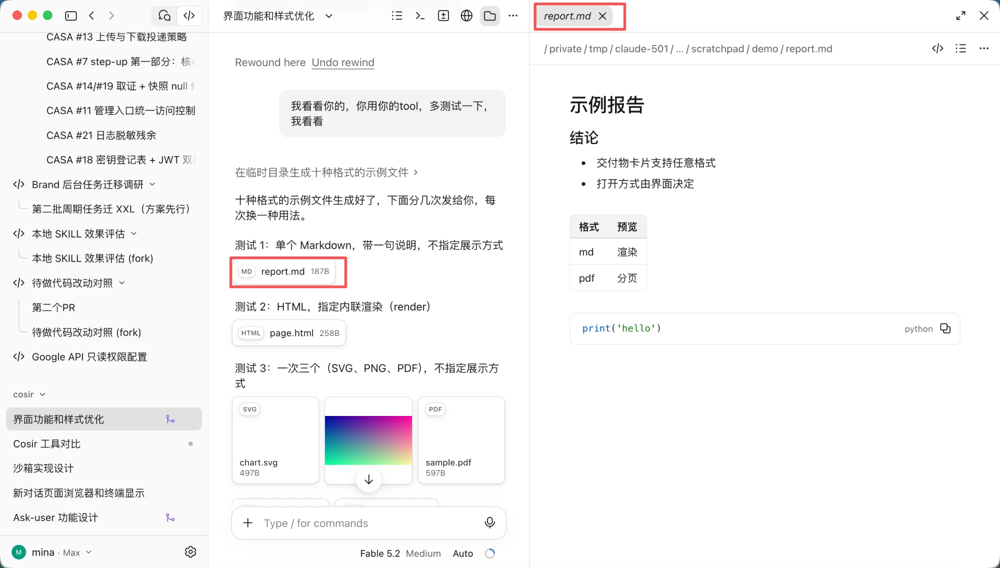

- 白底、细边框、圆角的小胶囊，单行：类型角标（灰色描边的大写后缀）· 文件名 · 浅灰色的大小。
- 多个文件横向排开，放不下换行（见下面 `17-yaml-source`）。
- 整张可点，没有独立按钮；悬停出完整路径的提示条（`12-tsv-table`、`28-unknown-binary`）。
- 文件名过长时从中间截断，保住扩展名（`25-video-folder-permission`）。
- 说明文字不在卡片里，是卡片上方的一行正文。

取：单行胶囊、整张可点、悬停路径、中间截断、横排换行。
取：文字角标。不取：说明文字放卡片外（cosir 每个条目一句，放提示条）。

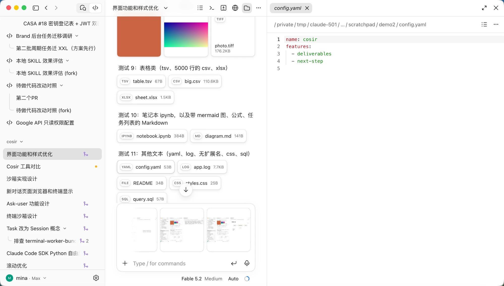

### 10.2 图片类卡片

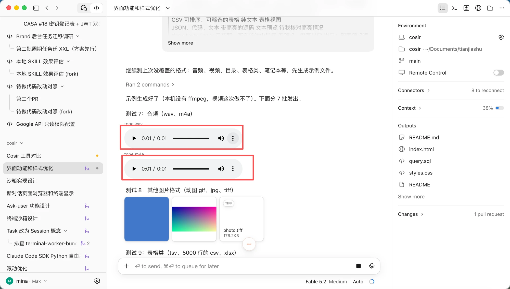

- 位图是正方形大方块，画面裁切铺满，方块上不显示文件名；动图在方块里播放。
- 取不到画面的格式（TIFF，以及 `05-pdf-viewer` 里的 SVG、PDF）是空白方块：左上角文字角标，左下角文件名与大小。
- 三个方块横排，与胶囊卡片分行。

取：位图用大方块、裁切铺满、动图播放。
不取：空白方块（cosir 对 SVG 用自身画面，对 PDF、Office、视频用系统缩略图，都取不到才退回图标）。

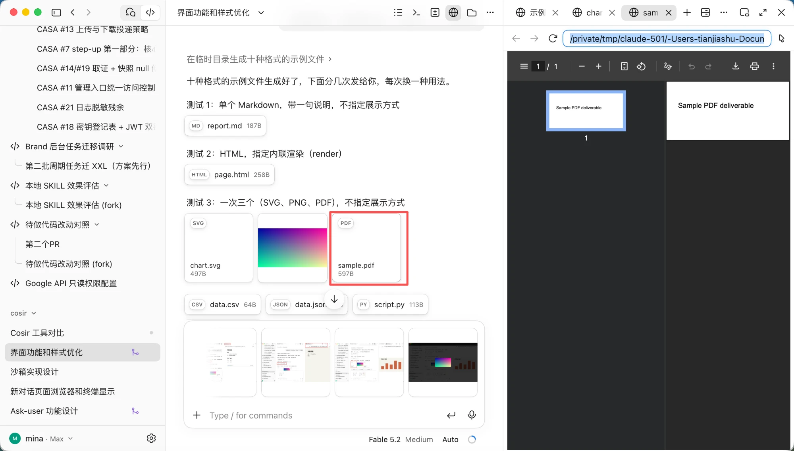

### 10.3 音频

见上面 `11-audio-players-and-outputs`：不是卡片，是灰色胶囊形的播放器，上方一行小字文件名，含播放键、进度、时长、音量与更多菜单。

取：对话里直接出播放器、文件名在上方。

### 10.4 文件面板

- 顶部是斜体文件名的标签，可关闭；下面一行灰色的路径（工作区外显示绝对路径并折叠中段，工作区内显示相对路径，对比 `01-markdown-panel` 与 `21-workspace-file-relative-path`）。
- 右上角三个图标：源码切换、大纲、更多。只有源码一种形态的文件没有源码切换（`07-json-source`）。

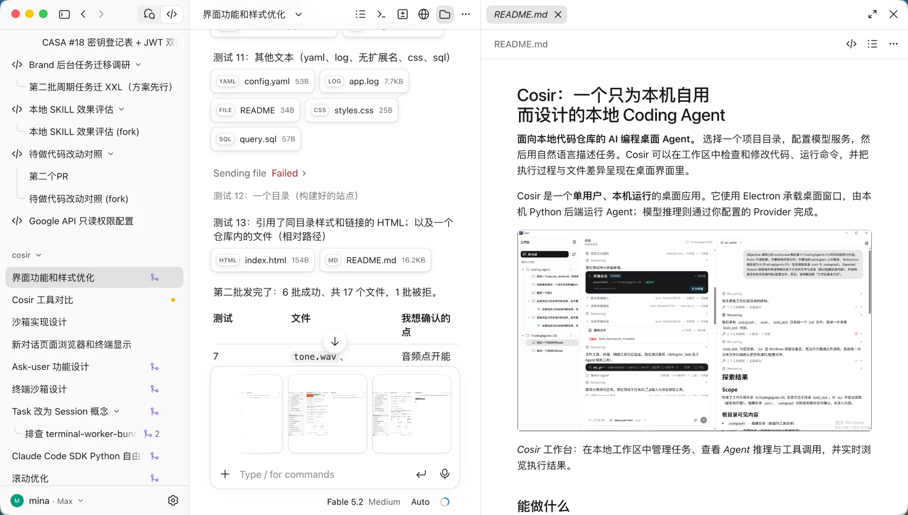

cosir 的文件面板已有同样的结构（路径、视图切换、更多），不改。

### 10.5 表格视图

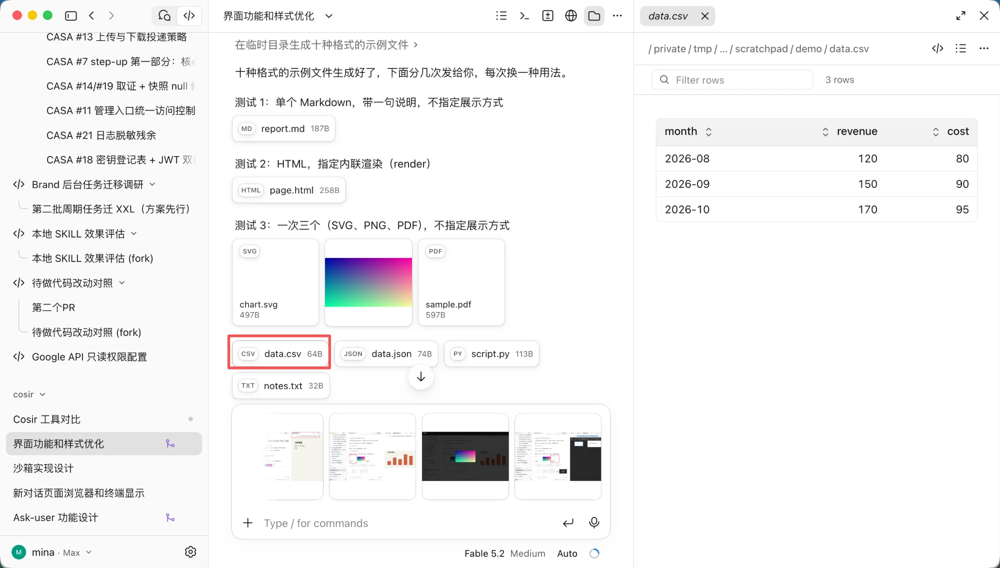

- 顶部一行：筛选输入框、行数。
- 表头浅灰底，每列带排序箭头；数字列右对齐，文本列左对齐；行间细分隔线；表格有圆角外框，不铺满面板宽度。
- 超过 500 行时在表格上方提示切到源码（`13-csv-500-row-limit`）。

取：筛选框加行数、排序箭头、数字右对齐、圆角外框。
不取：500 行上限（§4.5）。

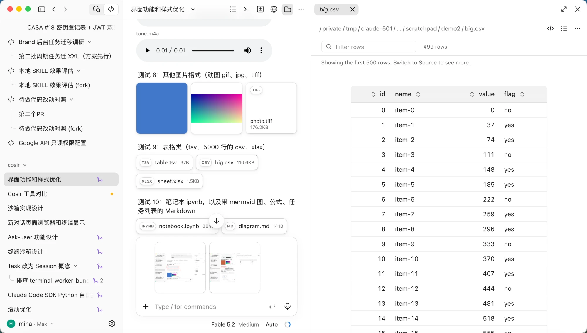

### 10.6 看不了的文件

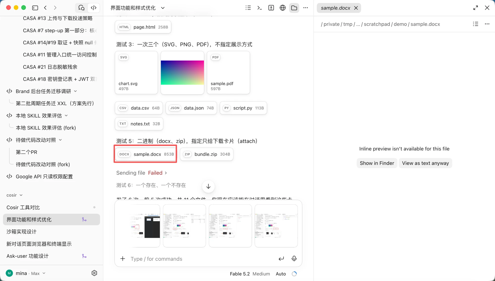

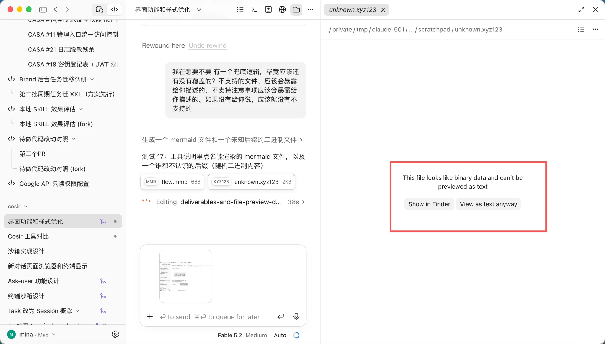

- 面板正中一句提示，下面一排浅灰底的按钮，四周留白。
- 两种提示语不同：认识的格式是「没有内联预览」，不认识的是「看起来是二进制数据」（cosir 的文案见 §4.4）。

取：居中布局、两种提示语。
cosir 另加：提示上方一张系统缩略图；认得的格式多出「快速查看」与「用系统应用打开」，「以文本方式查看」降为文字链接。

### 10.7 网址卡片

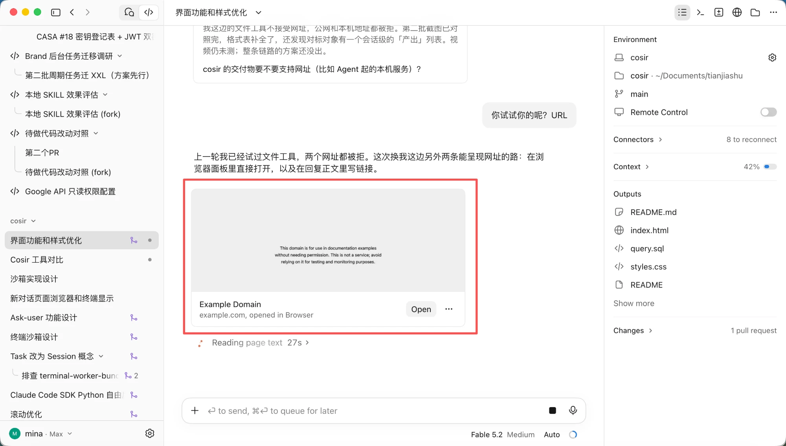

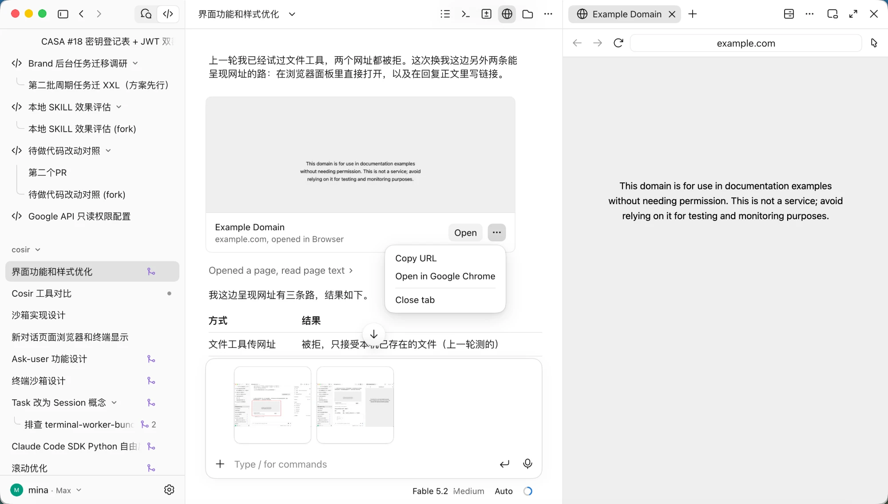

- 大卡片：上半部分是页面截图，下半部分左侧标题与「域名，已在浏览器打开」，右侧「打开」按钮与「…」。
- 「…」菜单：复制网址、在系统浏览器打开、关闭标签。
- 这张卡片来自「打开网页」的动作，不是文件工具，也不进 Outputs。

取：「…」菜单里的复制网址与用系统浏览器打开。
不取：页面截图（§7）；卡片绑定活的标签页（cosir 的网址条目是成果的指向，与文件条目同一种胶囊）。

### 10.8 会话级清单

见 `11-audio-players-and-outputs` 右栏的 Outputs：每行一个小图标加文件名，图标按类型分（文档、网页、代码、通用），超过五条折叠为「显示更多」。

取：单行条目、图标加名称、折叠。cosir 放在会话侧栏的「产出」卡片里（§4.6）。

### 10.9 对标对象没做好的地方（留作反例）

| 截图 | 问题 |
|---|---|
| [`26-video-save-dialog`](assets/deliverables-benchmark/26-video-save-dialog.webp) | 视频交给浏览器后落进「保存为」下载框 |
| [`25-video-folder-permission`](assets/deliverables-benchmark/25-video-folder-permission.webp) | 读桌面目录触发系统授权框（cosir 同样会遇到，见 §8） |
| [`15-ipynb-raw-json`](assets/deliverables-benchmark/15-ipynb-raw-json.webp) | 笔记本显示成一行原始 JSON |
| [`29-mermaid-file-render-flag`](assets/deliverables-benchmark/29-mermaid-file-render-flag.webp) | mermaid 文件指定内联渲染后仍是源码 |
| [`20-html-relative-assets`](assets/deliverables-benchmark/20-html-relative-assets.webp) | 网页引用的同目录样式疑似未生效（标题应为橙色） |

### 10.10 其余截图

各格式点开后的样子，实施时按需对照：[`02` HTML](assets/deliverables-benchmark/02-html-browser.webp)、[`03` SVG](assets/deliverables-benchmark/03-svg-browser.webp)、[`04` 图片放大](assets/deliverables-benchmark/04-png-lightbox.webp)、[`07` JSON](assets/deliverables-benchmark/07-json-source.webp)、[`08` Python](assets/deliverables-benchmark/08-python-source.webp)、[`10` 压缩包](assets/deliverables-benchmark/10-zip-binary.webp)、[`12` TSV](assets/deliverables-benchmark/12-tsv-table.webp)、[`14` xlsx](assets/deliverables-benchmark/14-xlsx-no-preview.webp)、[`16` Markdown 图表与公式](assets/deliverables-benchmark/16-markdown-mermaid-math.webp)、[`18` CSS](assets/deliverables-benchmark/18-css-source.webp)、[`19` SQL](assets/deliverables-benchmark/19-sql-source.webp)、[`23` 网址卡片与浏览器](assets/deliverables-benchmark/23-url-card-with-browser.webp)、[`27` mermaid 源码](assets/deliverables-benchmark/27-mermaid-file-source.webp)。

## 11. 界面设计

设计稿是一张可打开的页面：[`assets/deliverables-ui-mockup.html`](assets/deliverables-ui-mockup.html)（颜色、圆角、字号照抄 `styles/globals.css` 的令牌，右上角切换深浅色；文档与视频的缩略图是占位画法）。§10 是对标对象长什么样，本节是 cosir 自己长什么样；两者冲突以本节为准。

**原则**：不新造视觉语言。胶囊没有外层卡片，图片用对话里唯一的图片外观（`ImageStrip` / `ImageTile`），侧栏卡用 `aside-card` 外壳，按钮用 `Button` 现有三档。新增的视觉元素只有三个：交付物胶囊、表格视图、二进制空态。

### 11.1 交付物（对话里）

照对标截图 `01`、`05`、`11`、`17` 的做法：一个文件一枚胶囊，有画面的文件用方块，没有外层卡片，直接跟在正文下面。

| 元素 | 规格 |
|---|---|
| 胶囊 | 高 36、圆角 `--radius`、细边框、`shadow-xs`、底色 `--card`；横排、间距 8、放不下换行。胶囊本身是容器，里面并列两个按钮：主按钮（角标、文件名、大小）与次按钮（「在文件夹中显示」图标），不嵌套 |
| 角标 | 描边的圆角小标，大写后缀，9.5 / 600、次要色；目录与网址换成线性图标 |
| 文件名 | 14 / 500，最宽 260，中间截断（扩展名与结尾始终可见） |
| 大小 | 12 / 次要色、等宽数字；目录写「文件夹」，网址写主机名加外链箭头 |
| 悬停与焦点 | 胶囊内任一按钮悬停或取得焦点时，底色变灰，次按钮出现在大小的位置；提示条挂在主按钮上，第一行是模型写的说明，第二行是完整路径。键盘按 Tab 先到主按钮、再到次按钮 |
| 方块 | 120×96（沿用 `ImageTile` 的尺寸与圆角）。图片只有画面、不写文件名，点开进灯箱；PDF、Office、视频填系统缩略图，左上角标、底部一条写文件名与大小，视频叠播放标记 |
| 音频 | 小字文件名在上，下面一条胶囊形播放条（播放键、时间、进度），高 36 |
| 顺序 | 方块一行 → 胶囊 → 音频。一个回合里多次交付物调用合成一组，按调用顺序排，同一指向只留最后一次 |

与对标对象的差别只有两处：对标取不到画面时是空白方块，这里填系统缩略图；对标的说明是卡片上方的一行正文，这里每个条目一句、放在提示条里（正文本身已经在介绍这些文件）。

### 11.2 状态

| 状态 | 表现 |
|---|---|
| 悬停 / 键盘焦点 | 见上；取得焦点的按钮另有 `focus-ring` |
| 不存在 | 虚线边框、文件名划线变灰、不可点，大小的位置写「已不存在」；不用警示色（文件被移走是正常事） |
| 没有权限（`ACCESS_DENIED`） | 锁形角标，大小的位置用警示色写「无访问权限」；主按钮不可用，次按钮常显 |
| 链接越界（`OUTSIDE_SCOPE`） | 与「不存在」同样的灰色虚线，大小的位置写「链接已失效」，不可点；不是用户能授权解决的问题，不用锁 |
| 工作区外 | 外观与普通胶囊一致，区别在提示条里的路径与主操作（阶段五之前是「在文件夹中显示」，§4.3） |
| 缩略图加载中 | 先显示占位方块（角标加文件名），到了再换 |
| 无系统缩略图（浏览器开发模式、Linux） | PDF、Office、视频退回胶囊；浏览器开发模式另没有次按钮 |

### 11.3 文件面板

- **表格视图**：筛选框与「匹配数 / 总行数」放进阅读工具栏；表头吸顶、点击排序（升 → 降 → 还原）；最左是原始行号，筛选排序后不变；数字列右对齐、等宽数字；横向滚动只发生在表格内；超限时表格上方一行「只显示前 N 行，文件共 X MB」并给「以源码查看全部」（§4.5）。
- **二进制空态**：居中一列——缩略图（最大 136 高，带投影）或通用图标、文件名、「类型 · 大小」、一句说明、出口按钮，文案与按钮以 §4.4 的表为准。「以文本方式查看」是文字链接，它几乎总是乱码，不与有用的出口同权重。
- **音视频**：视频黑底等比居中、原生控件；播不了时整块换成二进制空态并说明原因。
- **工作区外的标签**：工具栏右侧标「工作区外 · 只读」，没有「加入对话」与文件树定位。

### 11.4 侧栏「产出」卡

单行条目（类型标记 + 名称），最新在上；同一目标交付多次只留最近一次；不存在的划线变灰但保留；点击行为与对话里的卡片一致；没有交付物时整张卡不出现；数量只在折叠时显示在标题右侧（`aside-card` 现有行为）。

### 11.5 回合内的顺序

正文 → 产物区 → 下一步建议。产物区内沿用现有规则（`artifact-zone.tsx`）：本轮改动卡在前，其余按调用顺序，交付物组排在它所在的位置；间距沿用回合内现有的 `gap`。下一步建议的样式不变。

## 12. 修订记录（2026-11-15）

测试计划（`deliverables-and-file-preview-test-plan.md` §4）查出 21 个问题，按下表定案，正文已改：

| # | 问题 | 定案 | 落点 |
|---|---|---|---|
| P1 | 图片点开去哪 | 灯箱，删去偏离表那一行 | §1、§11.1 |
| P2 | 阶段一至四里工作区外文件的信息与出口 | 信息走按记录寻址的接口，阶段一就有；主操作在阶段五前是「在文件夹中显示」 | §4.1、§4.3、§4.7 |
| P3 | 工作区外的目录 | 始终「在文件夹中显示」，不做授权浏览 | §4.3 |
| P4 | 按目录校验放行整棵子树 | 句柄真实路径须等于记录的 `real_path`，每次读取重查受保护路径 | §4.7 |
| P5 | 两种 403 共用一句 | 拆成 `ACCESS_DENIED` 与 `OUTSIDE_SCOPE`，越界不画锁 | §4.7、§11.2 |
| P6、P7 | 归类依赖本机 `mimetypes`；文档类型没有清单 | 显式后缀表与 `system_preview` 字段 | §4.2 |
| P8 | 视频可播性只在 macOS 成立 | 不写死，靠失败回调降级；自动化只用 wav、ogg、webm | §8 第 5 项 |
| P9 | 表格超限三种说法、末行截断 | 解析开头一段、丢最后一行、上方提示 | §4.5、§11.3 |
| P10 | 二进制空态文案与按钮不一 | §4.4 的表为唯一版本 | §4.4、§11.3 |
| P11 | 降级不分失败原因 | 只对「显示不了」降级，读取失败与太大保留现有处理 | §4.8 |
| P12 | 产出清单的重算时机、继承、判等、形状 | 逐条定下 | §4.6 |
| P13 | 撤回后能否授权读取 | 不能，按 404 | §4.7 |
| P14 | 按钮里嵌按钮 | 容器内并列主、次两个按钮 | §4.3、§11.1、§11.2 |
| P15 | Linux 与假宿主 | Linux 无缩略图；假宿主平台需可配（测试计划同步） | §4.3、§4.4 |
| P16 | 估高静默变 0、换行后不成立 | 改读 `items`，按行数估算 | §6 |
| P17 | 指向音视频的网址进内置浏览器 | 按后缀表交系统浏览器 | §4.3 |
| P18 | 「一律转 PNG」言过其实 | 只加 TIFF，HEIC 等归系统预览 | §4.2 |
| P19 | 图片卡每次重下原图 | 缩略尺寸参数，按版本缓存 | §4.3 |
| P20 | TIFF 转码被标「大图缩略预览」 | 只有缩小时才带该响应头 | §4.2 |
| P21 | 产物区顺序与数量显示 | 沿用产物区现有顺序；数量只在折叠时显示 | §11.4、§11.5 |

另外两处随之修正：新增侧栏卡片会清掉用户的侧栏偏好（§4.6）；提示词写死工具名没有守卫（§6）。
